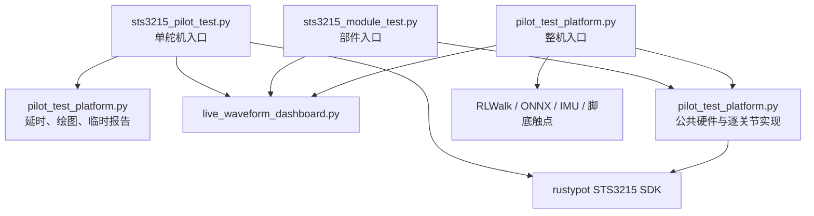

# OpenDuck Mini 三种测试方法代码实现文档

**版本：** V2.3  
**日期：** 2026-07-30  
**适用硬件：** 飞特 STS3215、OpenDuck Mini 电机驱动板、树莓派 Zero 2W

## 1. 文档目的

本文按当前仓库中的真实代码说明三种测试方法如何实现：

1. 新舵机安装前的单舵机检测；
2. 左腿、右腿或头部组装完成后的部件检测；
3. 14 个舵机全部装配后的整机逐关节检测与 ONNX 步态验证。

本文重点解释入口函数、调用关系、数据结构、控制循环、判定条件和输出文件。运行人员的操作步骤另见测试文档。

## 2. 代码文件

| 文件 | 主要职责 |
|---|---|
| `scripts/sts3215_pilot_test.py` | 单舵机扫描、PID写入、90°波形、采样和单舵机报告 |
| `scripts/sts3215_module_test.py` | 自动识别左腿、右腿或头部，并调用公共逐关节测试 |
| `scripts/pilot_test_platform.py` | 14关节定义、公共扫描、PID、安全、±15°波形、指标、整机和步态 |
| `scripts/live_waveform_dashboard.py` | 实时HTTP服务、Canvas曲线、文件下载 |
| `tests/test_sts3215_detection_levels.py` | 单舵机/部件/整机ID分级测试 |
| `tests/test_pilot_test_platform.py` | 波形、延时、安全、报告和整机入口测试 |
| `tests/test_live_waveform_dashboard.py` | 实时数据发布和网页接口测试 |

核心依赖关系如下：



## 3. 固定配置与关节映射

公共配置位于 `pilot_test_platform.py`：

```python
SERIAL_PORT = "/dev/ttyACM0"
SERVO_BAUD_RATE = 1_000_000
CONTROL_FREQUENCY_HZ = 50
SAMPLE_PERIOD_S = 0.02
```

项目使用的 ID 与关节映射为：

```python
JOINTS = (
    ("left_hip_yaw", 20),
    ("left_hip_roll", 21),
    ("left_hip_pitch", 22),
    ("left_knee", 23),
    ("left_ankle", 24),
    ("neck_pitch", 30),
    ("head_pitch", 31),
    ("head_yaw", 32),
    ("head_roll", 33),
    ("right_hip_yaw", 10),
    ("right_hip_roll", 11),
    ("right_hip_pitch", 12),
    ("right_knee", 13),
    ("right_ankle", 14),
)
```

该顺序与现有 HWI 和 ONNX 策略的 14 维 action 顺序一致。扫描顺序使用 `EXPECTED_IDS=(10–14, 20–24, 30–33)`，动作和步态数据使用 `JOINTS` 顺序。

`open_controller()` 对 SDK 进行统一封装：

```python
rustypot.Sts3215PyController(
    "/dev/ttyACM0",
    1_000_000,
    0.5,                  # 单次通信超时；用户指定
)
```

逐关节动作循环对单次超时自动重试一次；连续两次、累计约1 s仍失败才关闭扭矩并报告通信中断。

扫描通过读取 `read_present_position(id)` 判断 ID 是否在线。扫描阶段只读寄存器，不写 PID、不使能扭矩、不发送位置。

## 4. 方法一：单舵机检测

### 4.1 入口与扫描

入口为 `sts3215_pilot_test.py:main()`。`scan_motor()` 遍历：

```python
PROJECT_MOTOR_IDS = [
    10, 11, 12, 13, 14,
    20, 21, 22, 23, 24,
    30, 31, 32, 33,
]
```

每个 ID 调用 `read_present_position()`：

- 无响应：忽略并继续扫描；
- 只有一个 ID 响应：返回 `(motor_id, initial_position)`；
- 无 ID 响应：抛出异常；
- 多个 ID 响应：抛出异常，防止把部件误当成单舵机测试。

### 4.2 PID处理

扫描完成后，程序先通过 `read_p_coefficient()`、`read_i_coefficient()`、`read_d_coefficient()`保存舵机原始 PID。

测试 PID 根据识别到的 ID 自动选择：

```python
test_kp = 8 if 30 <= motor_id <= 33 else 22
test_kd = 0
```

写入顺序为：

```text
write_lock(id, False)
→ write_mode(id, 0)
→ write_p_coefficient(id, test_kp)
→ write_d_coefficient(id, 0)
→ read_p_coefficient/read_d_coefficient回读
```

回读值不一致时立即结束，动作循环不会开始。原始 PID 只写入报告用于追溯，当前代码不会在测试结束后自动恢复。

### 4.3 输入波形

单舵机默认使用 `--amplitude-deg 90`、`--cycles 3`、`--half-cycle 2.0`。核心函数为：

```python
blend = 0.5 - 0.5 * cos(pi * phase)
position = start + (end - start) * blend
```

`waveform()` 用两个半余弦段组成一次：

```text
0° → 90° → 0°
```

代码把接线时的位置 `initial_position` 定义为测试原点，不先转到舵机绝对 0°。若原点加 90°会超过 `π rad`，则自动选择负方向：

```python
direction = 1 if origin + amplitude <= pi else -1
target = origin + direction * waveform(...)
```

因此图上的角度是相对原点位移；CSV 另外保存目标和实际绝对角度。

### 4.4 采样循环

采样周期默认 20 ms。每个周期按以下顺序执行：

```text
1. 计算当前相对目标角度
2. write_goal_position()发送目标
3. read_present_position()读取实际位置
4. 尝试读取速度、电流、电压、温度
5. 计算误差并追加一行数据
6. 发布到实时网页
7. 按next_sample补偿循环执行时间
```

每行数据包含：

```text
time_s, target_deg, actual_deg, error_deg,
target_absolute_deg, actual_absolute_deg,
speed_rad_s, current, voltage, temperature_c
```

位置主读写异常会累计 `communication_errors` 并跳过当前点。按当前中试要求，70℃以下不提示，超过70℃告警，75℃仅作为防损坏紧急断扭矩底线；温度不参与方向PASS/FAIL。飞特规格书本身给出的运行温度上限为60℃、过热保护边界为>70℃，报告会明确当前策略是项目覆盖值。单舵机当前实现中，电压和电流只记录，不调用公共 `SafetyMonitor`，因此低压、持续过流和持续大误差不会在本入口触发硬停机。

### 4.5 判定与输出

有效数据采集完成后计算：

```python
error = actual_deg - target_deg
rmse = sqrt(mean(error ** 2))
max_abs_error = max(abs(error))
mean_abs_error = mean(abs(error))
```

单舵机通过条件为：

```python
communication_errors == 0
and rmse <= 5.0
and max_abs_error <= 15.0
and signed_actual_peak >= amplitude_deg * 0.60
```

`estimate_position_delay()`计算响应延时和等效相位延时，但延时当前只记录，不参与 PASS/FAIL。

单舵机脚本只能验证编码器反馈是否沿发送指令方向运动。因为总线上没有其他关节，无法得到重力引起的多关节电流响应，所以不判定机械装配方向；该项必须在部件或整机脚本完成。

默认输出到：

```text
/tmp/openduck_test_logs/motor/motor_<ID>_<时间>/
```

包含 `samples.csv`、`summary.json`、`report.html`。

## 5. 方法二：组装部件检测

### 5.1 部件自动识别

入口为 `sts3215_module_test.py:run()`。组件定义为：

```python
MODULES = {
    "right_leg": (10, 11, 12, 13, 14),
    "left_leg":  (20, 21, 22, 23, 24),
    "head":      (30, 31, 32, 33),
}
```

第一次通过 `scan_all_project_ids()`扫描全部 14 个候选 ID，然后释放控制器。`identify_module()`使用集合包含关系识别组件：

```python
if detected_ids <= expected_component_ids:
    该组件是候选组件
```

处理规则如下：

- 扫描结果只属于一组：可以确定组件；
- 组件 ID 不完整：列出缺失 ID，禁止动作；
- 扫描结果跨多个组件：拒绝自动判断；
- 扫描到全部 14 个 ID：提示使用整机脚本；
- 只有当前组件的完整 ID 集合：允许继续。

`ModuleSelection`保存组件名称、期望 ID、已识别 ID、缺失 ID，并通过 `joints` 属性从公共 `JOINTS`中过滤出本组件关节。

### 5.2 动作前复查

识别完成后调用 `confirm_supported()`。交互终端直接按 Enter 表示已经可靠固定；非交互运行必须传入 `--yes`。

随后重新打开控制器，但只扫描当前组件 ID：

```python
scan_servo_ids(controller, selection.expected_ids)
```

第二次扫描避免操作者确认期间插头松动，同时不再等待其他 9 或 10 个无关 ID 超时。

### 5.3 复用公共逐关节函数

部件脚本不自己实现电机控制循环，而是调用：

```python
run_assembly_motion(
    controller,
    component_scan,
    joints=selection.joints,
    expected_ids=selection.expected_ids,
    amplitude_by_joint={
        joint_name: 15.0
        for joint_name, _ in selection.joints
    },
    sample_callback=dashboard.publish_motor_row,
)
```

因此部件测试与整机逐关节测试使用完全相同的 PID、波形、采样、安全和判定代码，仅 `joints`、`expected_ids` 和输出标题不同。

### 5.4 PID与安全起动

`run_assembly_motion()`首先调用 `apply_project_pid()`：

```python
target_kp = 8 if id in {30, 31, 32, 33} else 22
target_kd = 0
```

该函数先逐个读取原始 PID、解除锁定、设置位置模式，再使用同步写入接口批量写 Kp/Kd，最后逐个回读验证。

使能扭矩前先把每个 ID 的目标位置写成扫描时的当前位置：

```python
sync_write_goal_position(expected_ids, ordered_origins)
sync_write_torque_enable(expected_ids, [True, ...])
```

这样不会因舵机内部残留旧目标而在使能瞬间跳动。

### 5.5 `0→+15→0→-15→0`波形

部件幅度由 `MODULE_TEST_AMPLITUDE_DEG=15.0`固定。`centered_two_angle_waveform()`把总动作拆成四个 1 s 段：

```text
第1段：0 → +1
第2段：+1 → 0
第3段：0 → -1
第4段：-1 → 0
```

局部相位 `u∈[0,1]`，四段函数为：

```text
g1(u) =  (1-cos(πu))/2
g2(u) =  (1+cos(πu))/2
g3(u) = -(1-cos(πu))/2
g4(u) = -(1+cos(πu))/2
```

最终目标：

```python
offset = radians(15) * g(elapsed)
target = assembly_origin + offset
```

动作前检查 `origin±15°`是否仍在 `[-π, π]`范围内，余量不足则安全终止。每次只改变当前被测关节的目标；同一组件的其他关节持续保持各自装配原点。

### 5.6 遥测与相对坐标

当前关节每 20 ms 执行同步目标写入，然后读取：

```text
实际位置、原始电流、电压、温度
```

电流由 `current_to_amp()`按 `raw × 0.0065 A`换算。报告曲线使用相对装配原点坐标：

```python
target_deg = degrees(target - origin)
actual_deg = degrees(actual - origin)
error_deg = actual_deg - target_deg
```

CSV同时保留：

```text
target_absolute_deg
actual_absolute_deg
```

整段部件测试使用全局累计 `time_s`；实时网页在选择某个关节后，用该关节首个样本重新归零显示。

### 5.7 安全与判定

`SafetyMonitor.check()`在每个有效采样点执行：

| 条件 | 代码行为 |
|---|---|
| 电压低于6.8 V | 立即抛出 `SafetyAbort` |
| 电流绝对值超过2.0 A并累计0.50 s | 抛出 `SafetyAbort` |
| 温度不超过70℃ | 不提示，不参与方向PASS/FAIL |
| 温度超过70℃ | 每个ID只打印一次告警 |
| 温度达到75℃ | 防损坏紧急断扭矩；当前项目安全底线 |
| 误差绝对值超过20°并累计0.30 s | 抛出 `SafetyAbort` |
| 位置或遥测读写异常 | 作为通信中断抛出 `SafetyAbort` |

`finally`始终调用 `disable_torque()`。该函数先尝试同步关闭；失败后逐个关闭，避免清理异常覆盖原始异常。

每个关节动作结束后计算 RMSE、最大绝对误差、平均绝对误差和延时。单关节通过条件为：

```python
rmse <= 5.0 and max_abs_error <= 15.0
```

全部关节均 PASS 时，组件才 PASS。

方向判定还会写入每个关节的 `direction` 字段。位置反馈方向失败，或已加载基准后明确得到反向电流特征时，该关节直接改为 FAIL；未标定和待复核不直接改写跟踪结果。

### 5.8 当前实测

2026-07-29 左腿组件已完成实测：

- 已识别 ID：20、21、22、23、24；
- 缺失 ID：无；
- 每关节 200 个样本；
- 最大 RMSE：1.3955°；
- 最大绝对误差：2.5287°；
- 位置延时：61.458–81.976 ms；
- 总体结论：PASS。

## 6. 方法三：整机检测

### 6.1 命令分支

整机入口为 `pilot_test_platform.py:run_session()`，支持：

```text
assembly：只执行14关节逐个波形检测
gait：只执行ONNX自动步态
all：先assembly，通过后再gait
```

不写子命令时默认为 `all`。三个分支开始前都会完整扫描 14 个 ID；任一 ID 缺失都不会进入动作。

### 6.2 整机逐关节检测

`assembly`分支再次扫描 14 个 ID，然后直接调用公共：

```python
run_assembly_motion(controller, assembly_scan)
```

默认参数即：

```python
joints = JOINTS
expected_ids = EXPECTED_IDS
amplitude_by_joint = JOINT_AMPLITUDE_DEG  # 每关节15°
```

因此整机逐关节阶段的实现与部件阶段相同，但测试对象由一个组件扩大为全部 14 个关节。每次只运动一个关节，其他 13 个关节保持扫描时位置。任一关节 FAIL 时：

- `assembly`返回 FAIL；
- `all`停止，不进入步态；
- 报告仍保存已采集数据和失败原因。

### 6.3 ONNX步态初始化

`gait`阶段由 `run_gait_motion()`实现。程序先检查 ONNX 模型和配置文件存在，再延迟导入 `RLWalk`，避免开发机在没有 GPIO、IMU 依赖时无法导入测试模块。

当前初始化代码为：

```python
walk = RLWalk(
    model_path,
    duck_config_path=config_path,
    serial_port="/dev/ttyACM0",
    control_freq=50,
    pid=[22, 0, 0],
    action_scale=0.0,
    commands=False,
    min_motor_voltage=6.8,
)
```

初始化后立即检查：

```text
IMU get_data()必须返回dict
脚底触点get()必须返回2个值
```

需要注意：当前 `RLWalk` 初始化参数是统一 `pid=[22,0,0]`。逐关节阶段虽然对头颈写入 Kp=8，但如果 `RLWalk` 初始化会重新写全部舵机 PID，则步态阶段头颈也会变为 Kp=22。此处是当前代码状态，后续若要求步态阶段仍保持头颈 Kp=8，应检查 HWI 的 PID 写入行为并改为分 ID 配置。

### 6.4 固定步态序列

`gait_segments()`定义 50 Hz 的有限动作序列：

| 阶段 | 控制周期 | 命令 `[vx, vy, yaw]` | action_scale |
|---|---:|---|---|
| 站立 | 100 | `[0, 0, 0]` | 0→0 |
| 原地踏步 | 150 | `[0, 0, 0]` | 0→0.2 |
| 前进 | 250 | `[0.10, 0, 0]` | 0.2 |
| 停止 | 100 | `[0, 0, 0]` | 0.2→0 |
| 左转 | 150 | `[0, 0, 0.15]` | 0→0.2 |
| 右转 | 150 | `[0, 0, -0.15]` | 0.2 |
| 最终停止 | 100 | `[0, 0, 0]` | 0.2→0 |

阶段内幅度变化由 `interpolate_scale()`使用半余弦平滑升降，避免动作幅度阶跃。

### 6.5 50 Hz推理和控制循环

每个控制周期执行：

```text
1. walk.get_obs()读取101维观测
2. 从obs[13:27]恢复14关节实际位置
3. 从obs[0:3]、obs[3:6]、obs[97:99]取得IMU和脚底信息
4. 更新模仿步态相位cos/sin
5. policy.infer(obs)执行ONNX推理
6. 校验输出必须是14维有限数
7. motor_targets = init_pos + action × action_scale
8. walk.hwi.set_position_all()发送14关节目标
9. 执行安全检查并记录数据
10. 睡眠补足20 ms周期
```

电压、电流和温度以约 10 Hz 批量读取，位置、误差、IMU和脚底数据以 50 Hz 记录。宽表 `gait_samples.csv`包含：

```text
阶段、速度命令、action_scale、
最低电压、最高电流、最高温度、
左右脚底触点、陀螺仪、加速度计、
14关节目标/实际/误差/电流/电压/温度
```

步态结束后按关节计算 RMSE 和最大绝对误差。14 个关节全部满足 5°/15°阈值时步态 PASS。

无论正常、异常还是 `RLWalk`构造中途失败，`finally`都会调用 `walk.hwi.turn_off()`或 `emergency_disable_all()`关闭扭矩。

## 7. 响应延时实现

`estimate_position_delay()`不是用单个峰值作差，而是用整段目标/实际数据做归一化互相关：

1. 取同时具有 `time_s`、目标位置、实际位置的样本；
2. 用相邻时间差的中位数得到实际采样周期；
3. 在 `±0.50 s`范围内枚举整数采样点偏移；
4. 对每个偏移计算去均值后的归一化相关系数；
5. 取相关系数最大的偏移作为响应延时；
6. 相关系数相同时选择绝对偏移更小的结果。

输出字段：

```text
position_delay_ms
phase_delay_deg
delay_correlation
```

固定周期波形的相位延时为：

```text
phase_delay_deg = delay_s / waveform_period_s × 360°
```

正值表示实际输出滞后。步态没有固定周期，因此只输出毫秒延时和相关系数。延时目前不参与二值判定。

## 8. 串口、网页端口和实时数据实现

### 8.1 两种“端口”的区别

代码中存在两个完全不同的端口：

| 类型 | 配置 | 作用 |
|---|---|---|
| Linux串口设备 | `/dev/ttyACM0` | 树莓派与电机驱动板通信 |
| HTTP网络端口 | 默认TCP `8765` | Windows浏览器读取实时数据和下载报告 |

串口使用 `1,000,000 bit/s`，负责向 STS3215 写目标位置并读取反馈。HTTP端口不直接控制舵机，只读取测试循环已经放入内存的数据，并在测试完成后提供文件下载。

完整链路为：

```text
STS3215
  ↓ 串联总线
电机驱动板
  ↓ /dev/ttyACM0，1 Mbps
rustypot控制器
  ↓ Python测试循环
采样行dict
  ↓ sample_callback
LiveWaveformDashboard内存队列
  ↓ HTTP :8765
Windows浏览器Canvas
```

### 8.2 HTTP服务启动

`LiveWaveformDashboard`只使用 Python 标准库：

```python
from http.server import BaseHTTPRequestHandler, ThreadingHTTPServer
```

三个测试入口默认都会构造：

```python
dashboard = LiveWaveformDashboard(port=8765)
dashboard.start()
```

`start()`内部把处理器类定义为闭包，使HTTP请求可以访问当前 `dashboard`实例。端口绑定代码等价于：

```python
for port in range(requested_port, requested_port + 20):
    try:
        server = ThreadingHTTPServer(("0.0.0.0", port), Handler)
        break
    except OSError:
        continue
```

因此8765占用时会继续尝试8766至8784。`0.0.0.0`表示监听树莓派所有网络接口，而不是只允许树莓派本机访问。

服务器在守护线程中执行：

```python
threading.Thread(
    target=server.serve_forever,
    name="openduck-live-waveform",
    daemon=True,
).start()
```

测试控制循环继续在主线程运行，网页请求不会阻塞舵机采样。

### 8.3 局域网地址输出

`_lan_address()`创建UDP socket并连接 `8.8.8.8:80`，借此读取操作系统为默认路由选择的本机IP；失败时回退到主机名解析，最后才回退 `127.0.0.1`。

启动成功后执行：

```python
self.url = f"http://{address}:{self._server.server_port}/"
print(f"实时曲线：{self.url}")
```

程序只是把URL输出到终端，不调用浏览器。Windows Terminal识别该字符串后，操作者可以按住 Ctrl 单击。网页访问依赖Windows电脑和树莓派处于同一局域网。

### 8.4 三个测试脚本怎样发布数据

实时类对外提供统一方法：

```python
dashboard.publish(
    joint,
    time_s=...,
    target_deg=...,
    actual_deg=...,
    error_deg=...,
    current_a=...,
    stage=...,
)
```

三种测试接入方式不同：

#### 单舵机

`sts3215_pilot_test.py`在每次成功读完反馈后直接调用：

```python
dashboard.publish(
    f"ID {motor_id}",
    time_s=elapsed,
    target_deg=target_deg,
    actual_deg=actual_deg,
    error_deg=actual_deg - target_deg,
    current_a=current_to_amp(current),
    stage="单舵机波形检测",
)
```

#### 组装部件

`sts3215_module_test.py`把回调传入公共动作函数：

```python
run_assembly_motion(
    ...,
    sample_callback=dashboard.publish_motor_row,
)
```

`publish_motor_row()`从长表行中提取 `joint`、`target_deg`、`actual_deg`、`error_deg`和 `current_a`，再调用统一 `publish()`。

#### 整机

整机逐关节阶段与部件相同，使用 `publish_motor_row()`。步态阶段一行包含14个关节，入口传入：

```python
sample_callback=lambda row: dashboard.publish_gait_row(row, JOINTS)
```

`publish_gait_row()`遍历14个关节，把一行宽表拆成14条实时关节数据。

### 8.5 内存队列和线程安全

服务使用：

```python
defaultdict(lambda: deque(maxlen=1600))
```

每个关节最多保留最近1600个采样点。`publish()`在 `threading.Lock`保护下：

1. 增加全局序号 `seq`；
2. 更新测试阶段和状态；
3. 把采样点追加到对应关节队列。

主线程负责写入，HTTP线程负责读取，锁用于防止同时访问时得到半条数据。

### 8.6 HTTP接口

`BaseHTTPRequestHandler.do_GET()`实现以下接口：

| 路径 | 代码行为 |
|---|---|
| `/`或`/index.html` | 返回内置的 `DASHBOARD_HTML` |
| `/api/data?joint=...&after=...` | 调用 `snapshot()`返回增量JSON |
| `/report.html` | 读取已注册的最终HTML报告 |
| `/download/<token>` | 下载已注册白名单中的CSV或JSON |
| 其他路径 | 返回HTTP 404 |

所有响应设置 `Cache-Control: no-store`，防止浏览器缓存旧数据或旧报告。

`snapshot(joint, after)`只返回 `seq > after`的采样，并限制本次响应最多250点。JSON结构为：

```json
{
  "status": "测试进行中",
  "stage": "逐关节检测",
  "joints": ["左髋偏航"],
  "joint": "左髋偏航",
  "samples": [],
  "downloads": []
}
```

### 8.7 浏览器增量轮询和绘图

浏览器端 `poll()`每150 ms执行一次：

```javascript
fetch(`/api/data?joint=${selectedJoint}&after=${lastSeq}`)
```

收到新点后追加到本地 `samples`，并把 `lastSeq`更新为最后一个序号。前端最多保留1200点。切换关节时清空本地数据并从序号0重新取得该关节当前缓冲区。

Canvas不依赖 ECharts、Plotly等第三方库，直接使用 `moveTo()`和 `lineTo()`绘制：

- 原始目标/实际位置叠加图；
- 按响应延时左移红线后的对齐图；
- 跟踪误差图；
- 电流图；
- 输入点、响应点和双向延时箭头；
- 输入函数、坐标单位和零点十字轴。

当前关节的首个样本被当作显示时间0，因此后测关节不会挤在全局时间轴末端；CSV仍保留全局累计时间。

## 9. 报告生成和通过HTTP端口输出

### 9.1 临时目录

`temporary_report_root(category)`基于 `tempfile.gettempdir()`构造：

```text
单舵机：/tmp/openduck_test_logs/motor/
部件：  /tmp/openduck_test_logs/module/
整机：  /tmp/openduck_test_logs/pilot/
```

`create_output_dir()`使用 `YYYYMMDD_HHMMSS`建立本次目录；同一秒重复运行时追加 `_01`、`_02`，避免覆盖。

### 9.2 单舵机报告代码

单舵机使用自己的 `write_outputs()`：

```python
csv_path = output_dir / "samples.csv"
json_path = output_dir / "summary.json"
html_path = output_dir / "report.html"
```

实现顺序为：

1. `csv.DictWriter`按采样行字段写 `samples.csv`；
2. `json.dump()`写入 `metadata`和 `summary`；
3. 使用Python字符串模板生成中文HTML；
4. 调用公共 `svg_position_chart()`和 `svg_series_with_zero_axes()`生成内嵌SVG；
5. `write_text(..., encoding="utf-8")`保存 `report.html`。

单舵机报告不需要外部图片、JavaScript或CDN，复制单个HTML文件即可离线打开。

### 9.3 部件报告代码

`sts3215_module_test.py`把所有输出放在 `finally`，即使扫描失败、安全停机或通信异常也会执行：

```python
write_csv(output_dir / "motor_samples.csv", MOTOR_CSV_FIELDS, motor_rows)
write_json(output_dir / "manifest.json", ...)
write_json(output_dir / "summary.json", summary)
render_report(output_dir, summary, motor_rows, [], report_joints=...)
```

`summary.json`包含：

```text
组件名称、期望ID、已识别ID、缺失ID、
原始PID、逐关节指标、总体结论、失败原因
```

`render_report()`只为当前组件关节生成判定表和波形，不显示未连接组件。

### 9.4 整机报告代码

`pilot_test_platform.py:run_session()`同样在 `finally`中执行：

```python
write_csv("motor_samples.csv", ...)
write_csv("gait_samples.csv", ...)
write_json("manifest.json", ...)
write_json("summary.json", summary)
render_report(...)
```

因此：

- `assembly`生成逐关节CSV，步态CSV为空表；
- `gait`生成步态CSV，逐关节CSV为空表；
- `all`同时生成两种数据；
- ID缺失或异常停机仍生成FAIL报告。

整机 `summary.json`保存扫描结果、安全阈值、assembly结果、gait结果和错误信息。`render_report()`遍历报告关节，生成逐关节指标表、原始时序图、响应对齐图、误差图和电流图。

### 9.5 报告怎样出现在8765网页

文件生成后，入口脚本执行：

```python
dashboard.set_report(report_path)
dashboard.set_downloads(
    [
        ("下载CSV原始数据", csv_path),
        ("下载JSON汇总", json_path),
    ]
)
dashboard.set_status("测试结论：通过（PASS）", "报告已生成")
```

`set_report()`只保存经过 `Path.resolve()`的报告路径。`set_downloads()`为每个允许下载的文件生成内部令牌：

```text
file-1
file-2
file-3
```

下一次浏览器请求 `/api/data`时，`snapshot()`在 `downloads`数组中返回按钮：

```json
{
  "label": "下载部件CSV原始数据",
  "url": "/download/file-1",
  "open_new": false
}
```

浏览器点击后请求：

```text
http://<树莓派IP>:<实际端口>/download/file-1
```

HTTP处理器只从 `_download_paths`白名单查找令牌，然后读取对应文件。CSV响应使用：

```http
Content-Type: text/csv; charset=utf-8
Content-Disposition: attachment; filename="motor_samples.csv"
```

JSON使用 `application/json; charset=utf-8`。中文HTML通过 `/report.html`在新标签页打开。这里不存在任意路径参数，因此浏览器不能使用URL读取树莓派其他文件。

### 9.6 报告生命周期

测试完成后，主线程在交互终端执行 `input()`，HTTP后台线程继续运行，网页和下载按钮保持可用。

操作者按 Enter 后：

```text
dashboard.close()
→ server.shutdown()
→ server.server_close()
→ cleanup_temporary_report()
```

`cleanup_temporary_report()`在删除前解析绝对路径，并确认目录位于系统临时根目录的 `openduck_test_logs`下；不满足条件时拒绝删除。`--keep-report`跳过清理，`--output-root`指定的持久目录也不会自动删除。

## 10. 三个入口脚本的完整调用顺序

### 10.1 单舵机

```text
__main__
→ main()
→ 创建rustypot控制器
→ scan_motor()
→ 读取原始PID
→ 启动LiveWaveformDashboard
→ 写入并回读项目PID
→ 20 ms控制/采样循环
→ estimate_position_delay()
→ write_outputs()
→ set_report()/set_downloads()
→ 等待Enter
→ close()/cleanup
```

顶层捕获 `KeyboardInterrupt`返回130，其他异常返回2，并显著打印FAIL原因。

### 10.2 组装部件

```text
__main__
→ main()
→ build_parser().parse_args()
→ run()
→ 启动LiveWaveformDashboard
→ scan_all_project_ids()
→ identify_module()
→ confirm_supported()
→ 只复查当前组件ID
→ run_assembly_motion()
→ calculate_joint_metrics()
→ finally写CSV/JSON/HTML
→ set_report()/set_downloads()
→ 等待Enter
→ close()/cleanup
```

主要退出码：

| 退出码 | 含义 |
|---:|---|
| 0 | PASS |
| 2 | 普通运行异常 |
| 3 | 指标判定FAIL |
| 4 | 安全停机 |
| 130 | 操作者中断 |

### 10.3 整机

```text
__main__
→ main()
→ build_parser().parse_args()
→ run_session()
→ 启动LiveWaveformDashboard
→ 扫描14个ID
→ confirm_supported()
→ assembly分支：run_assembly_motion()
→ gait分支：run_gait_motion()
→ finally写两种CSV、JSON和HTML
→ set_report()/set_downloads()
→ 等待Enter
→ close()/cleanup
```

`all`在assembly结果为PASS后才进入gait。所有异常路径最终都会生成报告并关闭扭矩。

## 11. 运行命令

每个新 SSH 会话都要重新激活虚拟环境：

```bash
# 进入OpenDuck Mini项目目录
cd /home/duck/open_duck_mini_runtime

# 激活包含rustypot和ONNX依赖的虚拟环境
source ~/.venv/bin/activate
```

单舵机：

```bash
# 自动扫描唯一舵机并执行单舵机波形测试
python scripts/sts3215_pilot_test.py

# 只扫描唯一舵机，不写PID且不发送动作
python scripts/sts3215_pilot_test.py --scan-only
```

组装部件：

```bash
# 自动识别左腿、右腿或头部并执行逐关节测试
python scripts/sts3215_module_test.py

# 只识别组件和缺失ID，不写PID且不发送动作
python scripts/sts3215_module_test.py --scan-only
```

整机：

```bash
# 只执行14关节逐个波形检测
python scripts/pilot_test_platform.py assembly

# 只执行整机ONNX自动步态
python scripts/pilot_test_platform.py gait

# 先执行逐关节检测，通过后再执行ONNX步态
python scripts/pilot_test_platform.py all

# 只扫描14个ID，不写PID且不发送动作
python scripts/pilot_test_platform.py all --scan-only
```

## 12. 当前实现边界

以下内容必须按代码现状理解：

1. 单舵机默认波形是一个方向的 `0→90°→0`，部件和整机才是 `0→+15°→0→-15°→0`。
2. 单舵机把通信次数、RMSE、最大误差和位置反馈方向纳入 PASS/FAIL；其电压、电流仅记录，未使用完整 `SafetyMonitor`。
3. 部件和整机逐关节测试使用完整低压、过流、过温、持续误差和通信停机保护。
4. 位置响应延时和相位延时目前只记录，不参与 PASS/FAIL。
5. `gait`可单独运行；只有 `all`明确要求逐关节阶段通过后才进入步态。
6. 整机步态当前传给 `RLWalk`的 PID 是统一 `[22,0,0]`，头颈 Kp=8 是否被保留需要结合 HWI 行为复核。
7. 报告默认只暂存在树莓派 `/tmp`，需在页面关闭前下载。
8. 非偏航关节的机械装配方向必须与人工确认正确的基准特征比较；没有基准时只记录，不做物理装反结论。
9. 偏航关节重力投影不足，电流方向法明确标记为“不适用”。

## 13. 自动测试

当前执行：

```bash
# 运行三类检测、公共安全和实时网页的全部无硬件测试
python -m unittest discover -s tests -v
```

共 41 项测试通过，覆盖：

- 单舵机只接受一个在线 ID；
- 三个组件的完整、残缺和跨组件识别；
- 整机缺 ID 时禁止动作；
- `0→+15→0→-15→0`波形；
- PID、误差、延时和二值判定；
- 70℃以上告警、75℃紧急停机、低压、持续过流和持续大误差；
- 中文报告、零轴、响应箭头和对齐曲线；
- 实时数据发布、增量轮询和文件下载入口。
- 位置反馈正负方向、电流特征同向/反向、偏航例外和基准文件读写。

## 14. 关节方向判定代码实现

### 14.1 为什么分成两层

舵机编码器只能说明“程序发正角度时，反馈角度是否也向正方向变化”，不能单独说明输出轴、连杆或关节是否按机械图纸方向装配。机械装反复核使用同一组件其他关节受重力耦合后产生的电流变化，但其符号会随组件朝向、支撑方式和线束阻力改变，因此必须和正确样件的特征比较。

代码把方向拆为：

```text
位置反馈方向：所有关节都判定，直接参与PASS/FAIL
重力电流方向：仅非偏航关节，必须加载正确样件基准
```

### 14.2 批量电流采集

`run_assembly_motion()`仍以50 Hz发送位置并读取当前关节反馈，每0.10 s额外调用一次：

```python
controller.sync_read_present_current(expected_ids)
```

`read_current_vector_amp()`检查返回数量，并按：

```python
current_a = raw_current * 0.0065
```

转换为安培。整组数据序列化到CSV字段：

```text
current_vector_a_json
```

批量电流属于附加方向数据。接口不支持或偶发读取失败时打印一次提示，原有位置与安全测试继续；方向项随后显示“数据不可用”，不会把附加采样失败误报成舵机动作通信中断。

### 14.3 位置反馈方向

`calculate_direction_metrics()`对每个关节取得相对原点的最大、最小实际位置：

```python
required = commanded_amplitude * 0.60
position_pass = (
    positive_actual_peak >= required
    and negative_actual_peak <= -required
)
```

部件和整机指令幅度为15°，方向有效位移要求为：

```python
required = max(3.0, commanded_amplitude * 0.20)
```

即正向至少+3°、负向至少−3°。3°远大于厂家规格中的≤0.5°齿隙，能够排除编码器噪声和机械虚位；跟踪精度仍由RMSE和最大误差单独判定。任何一侧方向未达到要求，`position_result=FAIL`，同时该关节最终结果变为FAIL。

单舵机只运动一个方向，因此根据自动选择的指令符号计算：

```python
signed_actual_peak = max(direction * actual_deg)
signed_actual_peak >= amplitude_deg * 0.60
```

### 14.4 多关节电流特征

对当前运动关节，在目标角度达到正、负幅度75%以上时分别取样。特征向量同时包含当前运动舵机和其他串联舵机：

```python
signature[id] = mean(current_at_positive_pose)
              - mean(current_at_negative_pose)
```

主动关节电流反映自身克服重力、摩擦和机构约束的负载，其他关节电流反映结构耦合。两者组合比只检查某一个电流正负稳定。基准特征范数小于0.01 A时，当前数据分辨率不足，结果标为 `REVIEW`，不会用量化噪声强行判反向。

### 14.5 基准生成与比较

操作者对人工确认装配正确的整机使用 `--save-direction-reference direction_references/robot.json`。只有逐关节跟踪和位置方向全部PASS时，`save_direction_reference()`才写入整机母基准JSON：

```json
{
  "format_version": 1,
  "expected_ids": [10, 11, 12, 13, 14, 20, 21, 22, 23, 24, 30, 31, 32, 33],
  "joint_profiles": {
    "left_hip_roll": {
      "servo_id": 21,
      "signature_a": {"20": 0.08, "22": -0.03}
    }
  }
}
```

母基准保存后，`split_robot_direction_reference()`按 `DIRECTION_REFERENCE_GROUPS`自动生成：

```text
direction_references/right_leg.json
direction_references/left_leg.json
direction_references/head.json
```

裁剪时只保留本组件内的观察舵机。例如左腿关节的子基准不会包含右腿和头部ID。正常整机测试自动加载 `robot.json`；部件脚本在 `identify_module()`后自动选择对应子基准，操作者不需要每次输入路径。显式 `--direction-reference PATH`仅用于维护覆盖。

`_cosine_similarity()`只比较本次测量和基准共同存在的观察ID：

```text
similarity ≥ +0.65：PASS，与正确装配基准同向
similarity ≤ −0.65：FAIL，疑似机械方向反向
其余：REVIEW，待人工复核
特征幅值过小：REVIEW
未加载基准：UNCALIBRATED
```

只有明确的 `current_result=FAIL`会把关节最终结果改为FAIL；`direction_failures`写入“电流特征与正确装配基准反向，疑似装配方向错误”，两个入口都返回退出码3。`REVIEW`和`UNCALIBRATED`保留在报告中，不自动判废。

### 14.6 偏航关节处理

以下关节绕偏航轴运动：

```python
YAW_JOINTS = {
    "left_hip_yaw",
    "right_hip_yaw",
    "head_yaw",
}
```

其重力矩随小角度偏航变化不稳定，`current_result`固定为 `NOT_APPLICABLE`。程序仍检查正负位置反馈、RMSE、最大误差和延时。若项目以后增加外部相机、编码标记或专用方向夹具，可在此分支接入独立判据，不应沿用重力电流阈值。

### 14.7 报告字段

`summary.json`在每个关节的 `direction`对象中保存：

```text
position_result
positive_actual_peak_deg
negative_actual_peak_deg
required_excursion_deg
current_result
current_similarity
current_note
positive_pose_samples
negative_pose_samples
signature_a
```

中文HTML表格显示“位置方向、重力电流方向、基准相似度、说明”，并在“多关节电流方向特征”表中逐项列出其他观察舵机的 `ΔI`。终端逐关节指标也按独立行对齐打印这两类方向结果。

### 14.8 判定指标来源

代码中的 `threshold_sources()`同时写入 `summary.json`和中文HTML。依据分为：

| 指标 | 当前值 | 来源 |
|---|---|---|
| 波特率 | 1 Mbps | 飞特STS3215规格书默认通信波特率 |
| 电压能力 | 4.0–7.4 V | 飞特STS3215规格书 |
| 中试欠压停机 | 6.8 V | OpenDuck内部保守阈值，用于保留步态负载裕量 |
| 当前温度策略 | >70℃告警、75℃紧急停机 | 用户指定项目策略；厂家规格为运行上限60℃、>70℃保护 |
| 过流 | 2.0 A持续0.50 s | 厂家为>2A持续2s保护；项目缩短为0.50s |
| RMSE/最大误差 | 5°/15° | OpenDuck内部中试工程阈值，非厂家标准 |
| 位置方向 | 同向位移≥3°且达到指令20% | 3°远大于厂家≤0.5°齿隙；内部方向门槛 |
| 电流相似度 | ±0.65 | 正确样机基准上的首版工程分类门槛 |

余弦相似度0.65约对应49.5°特征夹角。该值没有厂家标准或通用机器人标准可直接引用；必须在积累多台正确样机和故意反装样本后，依据两类相似度分布重新选择。代码注释和报告均明确标为“正确样机基准 + 首版工程阈值”。

厂家规格引用：深圳飞特模型有限公司《STS3215产品规格书》A/0，2020-04-10：  
<https://www.feetechrc.com/Data/feetechrc/upload/file/20200611/6372749961523760249976542.pdf>

### 14.9 当前正确整机母基准

2026-07-30使用人工确认方向正确、14个ID全部在线的整机完成实测。第三轮采集14个关节全部通过，并生成：

```text
direction_references/robot.json
direction_references/right_leg.json
direction_references/left_leg.json
direction_references/head.json
```

整机入口只读验证确认，在不传 `--direction-reference`时：

```json
{
  "loaded": true,
  "path": "/home/duck/open_duck_mini_runtime/direction_references/robot.json",
  "mode": "automatic"
}
```

使用同一轮CSV回放母基准：

- 左/右髋横滚、左/右髋俯仰的组合电流特征有效，相似度为1.0；
- 膝、踝和部分头颈关节的电流差分幅值低于0.01 A，标为 `REVIEW`；
- 左/右髋偏航和头部偏航标为 `NOT_APPLICABLE`；
- 14个关节位置反馈方向均为 `PASS`。

这表示当前系统能够对电流特征足够明显的非偏航关节做自动反向判定；弱电流特征关节仍依赖位置方向、波形精度和人工装配检查。文档不得把 `REVIEW`描述为已经具备可靠的机械装反识别能力。
