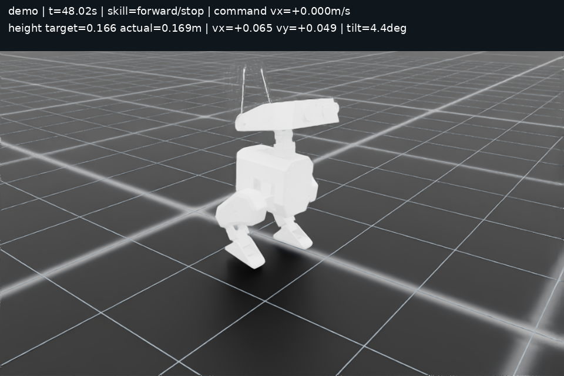

# Open Duck Mini v2 — Isaac Lab RL

STS3215 7.4V 기본 v2 모델의 전진·정지, 후진, 양발 낮은 자세·기립을 학습하고 재생한다.
Isaac Lab 2.2.0 / Isaac Sim 5.0.0.0 / RSL-RL 2.3.3의 PPO를 사용한다.

**기준 물성 평지에서 80/80회 통과했다. 실물과 새 동작의 도메인 랜덤화 검증은 아직 완료하지 않았다.**
후진은 20초에 평균 96.3mm의 옆 이동이 남는다. GitHub 공개는 코드·모델 배포이며 실물 검증을 의미하지 않는다.



## 처음 실행

[처음 설치](docs/PUBLIC_SETUP.md)를 완료한 뒤, 이 폴더에서 실행한다.

```bash
python3 tools/download_policies.py
./run.sh convert --headless
./run.sh test
./run.sh play-skills --demo
```

검증된 정책은 [Release](https://github.com/happylee8282/openduck_v2_ws/releases/tag/v0.2.0-isaac-multiskill)에서 제공한다. 다운로드 도구가 ZIP과 세 정책의 SHA-256을 검사한다.
생성 USD는 Git에 포함하지 않으므로 새 위치에서는 변환이 필요하다.

| 자료 | 내용 |
|---|---|
| [CLI 튜토리얼](docs/CLI_TUTORIAL.md) | 한 줄씩 실행: 재생 → 학습 → 새 후보 평가 → 영상 |
| [전체 RL 가이드](docs/PACKAGE_RL_GUIDE.md) | 구조·관측·행동·보상·PPO·재현 방법 |
| [개발 전후 수치 비교](docs/POLICY_EVOLUTION.md) | 초기 실패부터 보정·후진·자세 확장까지 |
| [세 정책 구현·검증](docs/MULTISKILL.md) | 모델별 역할, 전환, 시험 기준 |
| [Sim2Real](docs/SIM2REAL.md) | 좌표·모터 모델·실측해야 할 설정 |
| [출처](docs/UPSTREAM_SOURCES.md) | 참고한 GitHub와 고정 버전 |

## 구조

```text
Robots/                       URDF와 원본 메시
config/                       정책 계약, SHA 고정 manifest, 자세 IK 참조
open_duck_v2/                 좌표·모터·정책 로딩·명령 보정·세 정책 전환
open_duck_complex_terrain/    평지·후진·자세·험지 RL 환경
open_duck_imitation/          모방학습 실험
isaac_duck_teleop/            전진 재생과 actor 내보내기
tools/                       학습·평가·영상·정책 다운로드
tests/                       CPU 회귀 검사
docs/                        실행 가이드와 보존된 학습 설정·수치
validation/                  기존 실제 시뮬레이터 판정 JSON
policies/                    Release에서 받는 세 .pt (Git 제외)
logs/                        새 학습 결과 (Git 제외)
run.sh                       Isaac Python 실행 진입점
```

## 검증된 세 정책

| 정책 | 역할 | actor 관측 → 출력 |
|---|---|---|
| `flat_straight_v2.pt` | 전진·정지, 기존 가중치 보존 | 101 → 14 |
| `backward_v2.pt` | 후진 | 101 → 14 |
| `posture_v2.pt` | IK 참조 위의 낮은 자세·기립 잔차 제어 | 103 → 14 |

최종 선택은 [manifest](config/multiskill_policy.json)로 고정한다. `model_100.pt` 같은 숫자는 run 내부의 저장 iteration이며 성능 순위가 아니다.
목표각 제한, 관측 이력, IMU 방향 처리, 정규화와 자세 참조는 신경망 바깥에서도 필요하다.

| 기존 실제 Isaac Lab 시험, seed62/63 | 결과 |
|---|---|
| 정지 / 전진 / 후진 / 자세 / 전체 전환 | 각각 16/16, 총 80/80 |
| 전진 평균 속도 (초기 2초 제외) | +0.1076m/s |
| 후진 평균 속도 (초기 2초 제외) | −0.1030m/s |
| 자세 평균 높이 | 164.8 → 128.3 → 164.5mm |
| 전체 전환 최대 방향 오차 | 6.52° |

[seed62 판정](validation/multiskill_2026-11-10/smooth_seed62/assessment.json), [seed63 판정](validation/multiskill_2026-11-10/smooth_seed63/assessment.json), [집계](docs/evidence/metrics_summary.json).
이 수치는 2026-11-10의 저장된 시험 결과이며 공개 배포 시 다시 학습하여 얻은 수치가 아니다.
총질량 2.107141kg과 머리·목 0.581535kg을 유지했다. 실제 계측·강건화·실물 I/O 통합은 남아 있다.

라이선스: [BSD 3-Clause](LICENSE), [외부 출처와 라이선스](docs/UPSTREAM_SOURCES.md).
원래 개발 PC의 날짜별 기록은 [보존 문서](docs/LOCAL_WORKSPACE_HISTORY.md)에 있다.
