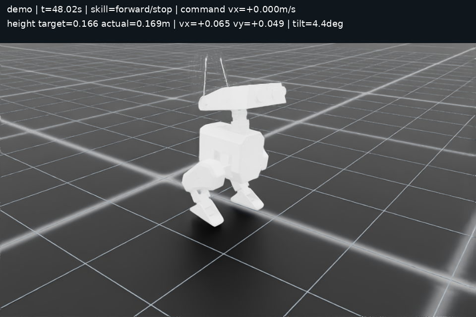
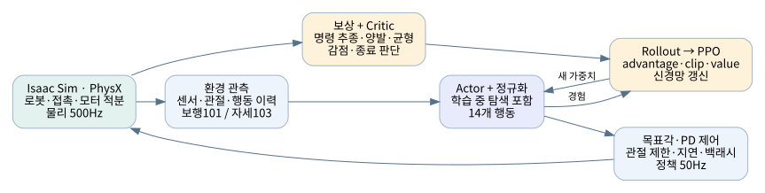
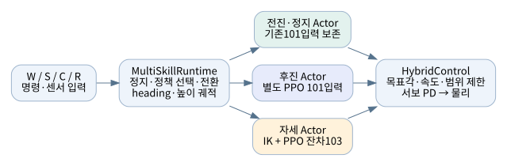
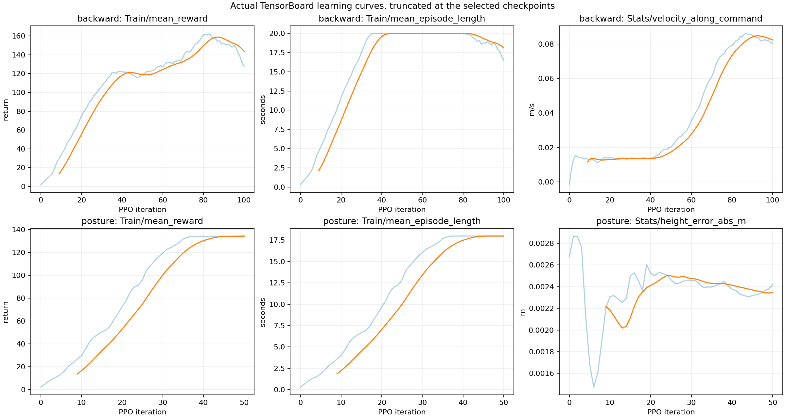
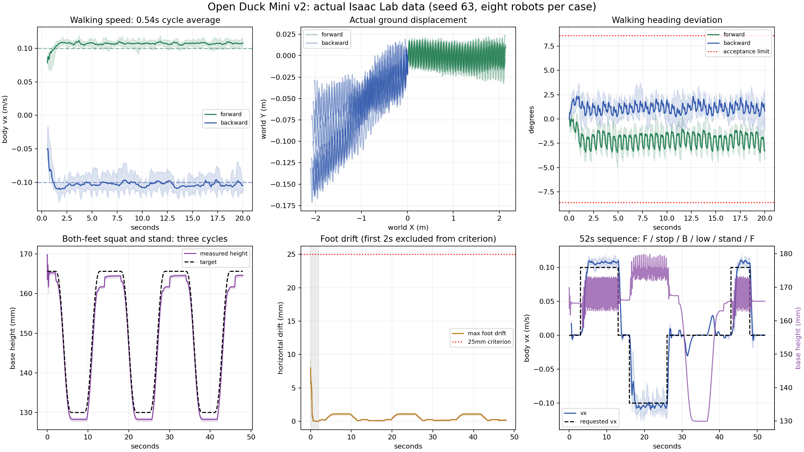

# Open Duck Mini v2 패키지 실행과 강화학습 가이드

2026년 11월 10일 기준 · v2 기본 구성 · STS3215 7.4V · Linux GPU PC

이 패키지는 Open Duck Mini v2를 Isaac Lab에서 학습하고, 저장된 정책을 재생하며, 영상과 수치로 동작을 평가하는 작업 환경이다. 처음 받는 사람은 **기존 정책 재생 → 구조와 RL 이해 → 별도 실험 학습 → 독립 평가** 순서로 진행하면 된다. 현재 전진·정지·후진·양발 낮은 자세와 기립은 기준 물성의 평지 시뮬레이션에서 검증했다. 실물 모터를 구동하는 통합 배포는 다음 단계다.



> GitHub 배포본에서는 [PUBLIC_SETUP.md](PUBLIC_SETUP.md)를 먼저 따른다.
> 이 문서의 `/home/happy/openduck_ws`는 원래 개발 PC 경로다. 공개 복제본에서는 저장소 루트의
> `./duck.sh` 또는 하위 `open-duck-isaac-lab/`의 `./run.sh`를 사용한다.
> 정책 파일은 Release에서 별도로 받으며 생성 USD는 각 PC에서 다시 변환한다.

## 1 다른 사람에게 먼저 설명할 내용

다음 문장을 소개에 사용할 수 있다.

> 이 프로젝트는 Open Duck Mini v2의 14개 관절을 Isaac Lab에서 강화학습하는 환경입니다. NVIDIA Isaac Sim과 PhysX가 로봇의 움직임을 계산하고, RSL-RL의 PPO가 관절 목표를 만드는 신경망을 학습합니다. 기존 전진·정지 정책은 보존하고 후진과 낮은 자세 정책을 별도로 추가했습니다. 사용자는 세 정책을 선택하는 런타임으로 로봇을 조작합니다. 학습 보상만 보지 않고 명령 속도, 방향, 발 접촉, 높이와 넘어짐을 별도로 검사합니다. 현재 성능은 평지 시뮬레이션에서 검증했으며 실물 적용에는 센서·모터 계측과 런타임 연결이 남아 있습니다.

전달받은 사람이 처음 할 일은 아래 세 가지다.

1. 현재 PC에서 `./duck.sh play-skills --demo`를 실행해 완성된 동작을 본다.
2. 이 문서의 구조·관측·행동·보상 설명으로 각 파일의 역할을 이해한다.
3. 기존 정책을 보존한 채 새 이름의 실험을 학습하고 평가 결과를 비교한다.

| 배우려는 내용 | 먼저 읽을 부분 | 완료 확인 |
|---|---|---|
| 실행과 시연 | 3장, 5장 | W/S 및 C/R 동작과 52초 데모 재생 |
| RL 원리와 코드 수정 | 4장, 6장, 7장, 8장 | 관측·행동·보상·PPO 설정 파일 설명 |
| 새 정책 개발 | 8장부터 12장 | 새 체크포인트를 다른 seed에서 평가 |
| 다른 PC로 전달 | 2장, 13장 | 수정 소스와 정책을 복원하고 USD 재생성 |
| 실물 적용 | 14장 | 좌표·주기·서보·IMU·접촉 계약을 계측 및 연결 |

## 2 저장소와 작업 환경의 관계

### 2.1 참고한 프로젝트

| 프로젝트 | 현재 작업에 제공한 것 | 기준 버전 |
|---|---|---|
| [apirrone Open Duck Mini](https://github.com/apirrone/Open_Duck_Mini) | 로봇 설계·기존 모델·공개 `BEST_WALK_ONNX_2` 보행 정책 | `b23317a485b3cec7d8417f352478778b3475173c` |
| [apirrone Open Duck Playground](https://github.com/apirrone/Open_Duck_Playground) | v2 관절 좌표·HOME·서보 모델·참조 보행 검토 | `b9be205ac64488c23504ca42e5ec790337adeec3` |
| [zhangzijie pro open duck isaac lab](https://github.com/zhangzijie-pro/open-duck-isaac-lab) | 현재 Isaac Lab 학습 패키지의 출발 소스 | `2e85abe5f22b61e9e121f74f91823a814e02734b` |
| [Isaac Lab](https://github.com/isaac-sim/IsaacLab/tree/v2.2.0) | Direct RL 환경·병렬 장면·물리 및 학습 실행 연결 | 2.2.0 |
| [RSL-RL](https://github.com/leggedrobotics/rsl_rl/tree/v2.3.3) | PPO·actor/critic·학습 저장과 TensorBoard 기록 | 2.3.3 |

**상류 원본 저장소와 이 배포본은 다르다.** 현재 수정 소스는 `happylee8282/openduck_v2_ws`의 `open-duck-isaac-lab/`에 포함한다. 학습된 세 정책은 Release와 SHA-256 검증 다운로드 도구로 복원한다. Isaac Lab 환경과 생성 USD는 각 PC에서 별도로 준비한다.

### 2.2 현재 PC의 폴더

```text
/home/happy/openduck_ws/
├── duck.sh -> open-duck-isaac-lab/run.sh
├── open-duck-isaac-lab/       현재 Isaac Lab 학습·재생 작업본
│   ├── Robots/               URDF·메시·생성 USD
│   ├── config/               정책 계약·선택 manifest·자세 참조
│   ├── policies/             검증된 전진·후진·자세 체크포인트
│   ├── open_duck_v2/         좌표·관측·모터·정책 런타임 공통 코드
│   ├── open_duck_complex_terrain/  평지·후진·자세·험지 환경
│   ├── open_duck_imitation/  참조 동작 학습 실험
│   ├── isaac_duck_teleop/    기존 101입력 정책 재생·내보내기
│   ├── tools/               학습·평가·영상·분석 실행 도구
│   ├── tests/               CPU 회귀 검사
│   ├── docs/                이 가이드와 상세 기술 문서
│   ├── logs/rsl_rl/         실험별 체크포인트·설정·TensorBoard
│   ├── validation/          원자료·판정 JSON·영상
│   └── run.sh               Isaac Python을 선택하는 실행 진입점
└── raspberry_code/          별도 실물 런타임 작업 폴더
```

`raspberry_code`는 별도 저장소다. 현재 Isaac Lab의 3정책 런타임과 실물 모터 I/O가 통합되어 검증된 것으로 취급하지 않는다.

### 2.3 두 Python 환경

| 작업 | 실제 경로 또는 실행 방법 | 환경 |
|---|---|---|
| 이번 Isaac Lab 학습·재생 | `~/openduck_ws/duck.sh` | `env_isaaclab`, Python 3.11, PyTorch |
| 이전 Mini·Playground 통합 | 아래 `outputs/Open_Duck/duck.sh` | 해당 폴더 `.venv`, Python 3.12, MuJoCo/MJX/JAX |

이전 통합 폴더는 `/home/happy/Documents/Codex/2026-10-28/https-github-com-apirrone-open-duck/outputs/Open_Duck`에 있다. 그 안의 `duck.sh train`은 Playground 학습을 실행한다. **현재 작업에는 `~/openduck_ws`의 `duck.sh`를 사용한다.** 같은 이름의 스크립트이므로 실행 전에 위치를 확인한다.

```bash
cd /home/happy/openduck_ws
readlink -f ./duck.sh
# /home/happy/openduck_ws/open-duck-isaac-lab/run.sh
```

## 3 현재 PC에서 바로 실행

### 3.1 재학습 없이 기존 동작 보기

현재 PC는 설치와 모델 변환이 되어 있다. `(base)` 프롬프트에서도 아래 스크립트가 Isaac Lab용 Python을 직접 선택한다.

```bash
cd /home/happy/openduck_ws
./duck.sh help
./duck.sh play-skills --demo
```

`--demo`는 52초 동안 다음 순서를 재생한다.

```text
정지 → 전진 → 정지 → 후진 → 정지
→ 양발 지지로 몸 낮추기 → 낮은 자세 유지 → 기립·안정화
→ 다시 전진 → 최종 정지
```

직접 조작하려면 다음을 실행하고 Isaac 창을 클릭해 키보드 포커스를 준다.

```bash
./duck.sh play-skills
```

| 키 | 동작 |
|---|---|
| W | 약 +0.1m/s 전진 명령 |
| S | 약 −0.1m/s 후진 명령 |
| 키 해제 또는 Space | 보행 정지 |
| C | 몸을 낮추고 그 자세 유지 |
| R | 다시 서기 |
| Esc | 재생 종료 |

C를 놓아도 낮은 자세를 유지한다. 낮은 자세에서 W/S를 누르면 먼저 일어서고 양발 접촉과 관절 안정화를 확인한 뒤 걷는다. 전진·후진 방향을 바로 반대로 바꾸면 먼저 정지하는 구간을 둔다. GUI 실행 창은 **GPU PC의 그래픽 세션**에 열린다. 일반 SSH 연결만으로 사용자 PC 화면에 자동 표시되지는 않는다.

### 3.2 화면 없이 실행 경로 확인

```bash
cd /home/happy/openduck_ws
./duck.sh play-skills --headless --steps 128 \
  --report validation/guide_cli_smoke.json
```

`--headless`는 창 없이 GPU 물리를 실행한다. 128스텝은 제어 시간 약 2.56초다. 이 짧은 검사는 파일 로딩과 실행 경로를 확인하며 전체 동작의 품질은 10장의 평가로 확인한다.

기존 전진·정지 전용 실행은 그대로 유지했다.

```bash
./duck.sh play
```

## 4 실행 구조와 파일 역할

### 4.1 학습 중 데이터 흐름



물리 엔진은 같은 로봇 여러 대를 병렬로 계산한다. 환경은 각 로봇의 센서·관절 값을 관측으로 만들고, actor가 행동을 출력한다. 제어기는 행동을 서보 목표각으로 바꾸고, 물리 엔진이 그 결과를 적분한다. 보상과 critic은 학습할 방향을 결정하며, PPO는 수집한 경험으로 신경망을 갱신한다.

### 4.2 재생 중 데이터 흐름



재생에서는 gradient나 PPO 갱신을 수행하지 않는다. 선택된 actor와 입력 정규화 값을 불러오고 명령에 따라 전진·후진·자세 정책을 선택한다. heading 전처리, 자세 궤적, 전환 처리와 모터 제어도 최종 동작의 일부다.

### 4.3 무엇을 바꾸려면 어느 파일을 보나

아래 파일 경로는 모두 저장소 루트 기준이다.

| 수정·확인 목적 | 파일과 진입점 |
|---|---|
| 관절 순서·HOME·좌표 오프셋·정책 주기 | `open_duck_v2/profile.py` |
| 관측 벡터 조립·행동 이력·목표각 처리 | `open_duck_v2/control.py` |
| 서보 PD·마찰·토크 처리 | `open_duck_v2/actuators.py` |
| 질량·마찰·모터·지연 랜덤화 | `open_duck_v2/randomization.py`, `open_duck_complex_terrain/open_duck_env_cfg.py` |
| 평지·후진 학습 명령 범위 | `OpenDuckStraightV6EnvCfg`, `OpenDuckBackwardEnvCfg` |
| 전진·후진에서 잘함/못함을 학습하는 보상 | `open_duck_complex_terrain/open_duck_env.py`의 `_get_straight_rewards`, `_get_gait_rewards` |
| 속도·명령 방향·정지 보상 공통식 | `open_duck_v2/straight_rewards.py` |
| 자세 동작의 높이·균형·발 접촉 보상 | `open_duck_complex_terrain/posture_env.py`의 `_get_rewards` |
| PPO 학습률·clip·epoch·네트워크 기본값 | `open_duck_complex_terrain/agents/rsl_rl_ppo_cfg.py` |
| 실제 전진·후진·자세 학습 실행값 | `tools/train_straight.py`, `tools/train_skill.py` |
| actor 초기화·고정 탐색·critic 준비 | `open_duck_v2/training_policy.py` |
| 정책 저장 계약·101입력 로딩 | `open_duck_v2/runtime.py` |
| 103입력 자세 계약·참조 파일 검사 | `open_duck_v2/posture_runtime.py` |
| 어떤 정책을 실행할지 선택·전환 | `open_duck_v2/multiskill.py` |
| 양발 낮은 자세의 참조·잔차 제어 | `open_duck_v2/posture.py`, `config/posture_reference_v1.json` |
| 선택된 정책 경로와 해시 | `config/multiskill_policy.json`, `config/validated_flat_policy.json` |
| 최종 동작이 기준을 만족했는지 판정 | `tools/assess_multiskill.py`, `tools/assess_straight_walk.py` |
| 실제 실행·관측·행동 원자료 | `validation/<시험명>/rollout.npz`, `evaluation.json` |

보상은 **학습 방향**, 평가 기준은 **결과 판정**이다. 로봇이 잘 걷는다는 근거를 확인하려면 보상 코드와 함께 `assessment.json`의 개별 검사 결과를 본다.

## 5 설치 환경과 모델 확인

### 5.1 확인된 버전

| 항목 | 검증 환경 |
|---|---|
| Python | 3.11.14 |
| Isaac Sim / Isaac Lab | 5.0.0.0 / 2.2.0 |
| RL 라이브러리 | RSL-RL 2.3.3 |
| PyTorch / torchvision | 2.7.0+cu128 / 0.22.0+cu128 |
| GPU / 드라이버 | RTX 5070 약 12GB / 580.178.04 |
| NumPy / Gymnasium | 1.26.4 / 1.2.0 |
| SciPy / Matplotlib | 1.15.3 / 3.10.0 |
| TensorBoard / ONNX | 2.20.0 / 1.20.0 |

위 표는 동작을 확인한 조합이다. `pyproject.toml`만 설치해도 Isaac Sim 전체가 설치되는 구조는 아니다. 현재 PC의 기본 경로는 다음과 같다.

```bash
export ISAACLAB_PATH=/home/happy/IsaacLab
export ISAAC_PYTHON=/home/happy/miniconda3/envs/env_isaaclab/bin/python
```

### 5.2 설치와 물리 경로 검사

```bash
cd /home/happy/openduck_ws
nvidia-smi
./duck.sh test
./duck.sh check --headless --steps 32 \
  --output validation/guide_isaac_check.json
```

CPU 회귀 검사와 실제 GPU 검사는 목적이 다르다. `test`는 계약·좌표·제어 논리를 확인한다. `check`는 USD 로딩, 관측 차원, 총질량, 토크 제한과 PhysX 랜덤화 readback 등을 확인한다. `check`가 통과해도 학습 정책이 잘 걷는다는 판정은 아니다.

### 5.3 로봇 모델을 다시 변환해야 할 때

다른 폴더로 옮기거나 다른 PC에서 복원하거나 URDF·메시를 수정하면 USD를 다시 만든다.

```bash
cd /home/happy/openduck_ws
./duck.sh convert --headless
./duck.sh python tools/validate_assets.py \
  --output validation/guide_assets.json
```

생성 파일은 `Robots/open_duck_mini_training.usd`다. USD에는 머신별 자산 경로가 들어갈 수 있어 기존 파일 복사만으로 복원했다고 판단하지 않는다.

현재 모델의 총질량은 약 2.107141kg이고 머리·목 4링크는 약 0.581535kg이다. 정책 50Hz, 물리 500Hz이며 모터 기준은 토크 3.35Nm, kp17.8, damping0.60, Coulomb 마찰0.052, armature0.028이다. 이 값은 기본 v2의 참조 모델이며 실물에서 식별한 피팅 결과는 아니다.

## 6 이 패키지의 강화학습 원리

### 6.1 용어와 한 번의 학습

| 용어 | 여기서의 의미 |
|---|---|
| 환경 | 지면·로봇·센서·명령·보상·종료 조건을 묶은 Isaac Lab 코드 |
| 관측 observation | actor에게 입력하는 센서와 제어 이력 벡터 |
| 행동 action | 14개 관절 목표를 계산하는 정규화된 출력 |
| actor 또는 policy | 관측에서 행동을 계산하는 신경망 |
| critic 또는 value | 현재 상태에서 앞으로 받을 보상을 추정하는 학습용 신경망 |
| reward | 속도 추종·접촉·높이·안정성 등에 주는 점수 |
| rollout | 현재 정책으로 물리를 실행해 수집한 경험 |
| iteration | rollout 수집 후 PPO로 신경망을 갱신하는 한 단위 |
| checkpoint | 네트워크·정규화·optimizer·정책 계약 등을 저장한 `.pt` |
| seed | 초기 난수 조건을 재현하기 위한 번호 |

PPO는 현재 정책으로 경험을 모은 뒤, 더 나은 행동의 확률을 높이되 한 번의 정책 변화가 과도해지지 않도록 clipping을 사용한다. actor와 critic을 함께 학습하며 재생에는 actor만 필요하다. 알고리즘의 배경은 [PPO 원 논문](https://arxiv.org/abs/1707.06347), 실제 사용한 구현은 [RSL-RL 2.3.3](https://github.com/leggedrobotics/rsl_rl/tree/v2.3.3)을 참고한다.

예를 들어 후진 기본값은 512환경에서 각각 32스텝을 모으므로 한 iteration에 `512 × 32 = 16,384`개의 새 transition을 수집한다. 각 환경은 한 번에 0.64초의 제어 시간을 진행한다. 물리 시간과 전체 학습에 걸리는 실제 시간은 다르다. GPU·동시 작업·렌더링에 따라 소요 시간이 달라진다.

### 6.2 actor가 보는 101개 값

전진·후진 actor 입력은 다음 순서로 고정된다. 순서를 바꾸면 길이가 같아도 다른 관측이 된다.

| 필드 | 개수 | 단위 또는 의미 |
|---|---:|---|
| 몸통 gyro | 3 | rad/s |
| 몸통 가속도 | 3 | m/s², 중력을 포함한 specific force |
| 명령 | 7 | vx, vy, yaw rate, 목/머리 목표 4개 |
| 관절 위치 − HOME | 14 | canonical 좌표 rad |
| 관절 속도 ×0.05 | 14 | 정해진 스케일 |
| 최근 행동 3개 | 42 | 14개씩 세 시점의 이력 |
| 모터 목표각 | 14 | canonical rad |
| 왼발·오른발 접촉 | 2 | 접촉 상태 |
| 위상 cos/sin | 2 | 선택 정책 보행 주기 0.54초 |
| 합계 | 101 | checkpoint 계약과 일치해야 함 |

전진·후진 critic은 222차원을 사용한다. actor101에 몸체 속도3, 높이1, 학습 문맥117을 붙인다. 선택된 평지 정책의 문맥에는 heading 오차와 옆 경로 오차가 들어간다. 이 world 상태는 학습의 reward/critic에 사용하며 actor 관측에는 추가하지 않는다. IMU 자세로 heading 명령을 보정하는 전처리는 actor 바깥에서 별도로 수행한다.

자세 actor는 여기에 목표 몸통 높이와 높이 속도를 더해 **103입력**을 사용한다. 자세 critic은 **126차원**이다. 자세의 행동 이력은 잔차 제어 이력이고 위상은 고정 `[1,0]`이다. 101입력과 103입력 정책을 임의로 서로 교환하지 않는다.

### 6.3 14개 출력이 모터 명령이 되는 과정

관절 순서는 왼다리5개 → 목·머리4개 → 오른다리5개다. 구체적인 이름·모터 ID·좌표 변환은 `profile.py`가 정의한다.

보행 actor의 평균 출력은 tanh를 거쳐 −1~1로 제한된다. 보행의 목표각은 기본적으로 다음과 같다.

```text
보행 목표각 = HOME + 0.25rad × action
자세 목표각 = 현재 높이의 IK 참조각 + 0.12rad × residual action
```

이후 관절 한계, 목표 변화 속도 제한, 지연·백래시 처리와 canonical→URDF 변환을 거쳐 서보에 전달된다. PD 액추에이터는 각도 오차·속도·마찰로 토크를 계산하고 토크를 제한한다. 정책은 몸체의 위치를 직접 이동시키거나 루트를 고정하는 명령을 내리지 않는다.

다리 목표 변화 제한은 5.24rad/s, 안정화 모드의 목·머리 목표 변화 제한은 1rad/s다. 후자는 실제 관절 속도를 1rad/s로 강제로 고정한다는 의미와 구분한다.

### 6.4 정규화와 초기화

선택 actor에는 학습된 정규화 값이 들어 있다. raw 관측을 같은 mean/std로 정규화한 뒤 네트워크를 호출해야 한다. ONNX/TorchScript 내보내기에도 이 처리를 포함한다.

전진 정책은 공식 `BEST_WALK_ONNX_2`에서 시작한 미세 학습 결과다. 후진은 그 전진 정책에서 별도로 시작했다. warm start는 actor와 normalizer를 가져오고 critic/optimizer는 새로 준비한다. 초기 40회 update는 critic을 준비하고 이후 actor도 갱신한다. 자세는 IK 참조 위의 초기 잔차 출력을 0으로 설정하고 별도 학습했다.

## 7 잘함과 못함을 정의하는 위치

### 7.1 보행 보상

`open_duck_complex_terrain/open_duck_env.py`의 `_get_straight_rewards`와 `open_duck_v2/straight_rewards.py`를 함께 본다.

| 보상 또는 감점 | 목적 |
|---|---|
| vx·vy·yaw rate 추종 | 명령의 속도와 방향을 따르게 함 |
| 명령 방향의 이동량 | 반대 방향 이동이나 제자리 버티기를 구별 |
| 정지 보상·잔여 이동 감점 | 0 명령일 때 서 있게 함 |
| 발 접촉·들림·공중 시간·보폭 | 양발이 번갈아 디디게 함 |
| world heading·옆 경로 오차 | 느리게 회전하거나 옆으로 누적 이탈하는 동작 억제 |
| 발 미끄럼·행동 급변·토크·머리 속도 | 불안정하거나 불필요한 동작 억제 |
| 넘어짐 감점과 episode 종료 | 자세 손실을 실패로 학습 |

보상용 속도는 EMA로 처리하는 부분이 있다. 평가에는 원시 속도와 0.54초 주기 평균을 별도로 보존한다. 보상 수치와 평가 수치를 같은 것으로 해석하지 않는다. reward 계수를 변경할 때는 실제 선택된 reward 분기의 상수도 확인한다. cfg의 오래된 이름을 바꾸는 것만으로 현재 분기에 적용되지 않을 수 있다.

### 7.2 자세 보상

`open_duck_complex_terrain/posture_env.py`가 목표 높이, 참조 몸통 자세, 참조 관절, 양발 접촉에 보상을 준다. 질량 중심 이탈, 평면 이동, 발 미끄럼, 잔차 크기·급변, 토크와 넘어짐을 감점한다. 참조 동작은 내려가기4초, 낮은 유지3초, 올라가기4초를 포함한다.

목표 높이는 약 165.6→130mm다. 실제 검증 평균은 약 164.8→128.3→164.5mm였다. 깊게 낮출수록 무릎 한계와 큰 머리의 균형 조건이 제약하므로, 현재는 양발을 둔 낮은 자세를 사용한다. 자세 중 몸통이 약25.5° 기울고 목·머리가 함께 보상한다.

### 7.3 최종 판정

최종 평가는 `tools/assess_multiskill.py`가 수행한다. 보행의 주요 조건은 20초 생존, 명령 방향 속도0.08~0.12m/s, 주기 평균 XY RMSE≤0.04m/s, world 옆 이동≤0.15m, 최대 heading≤0.15rad, 양발 반복 착지·들림이다. 자세는 25mm 이상 낮추기, 복귀 높이 오차≤10mm, 낮은 구간 양발 접촉≥95%, 발 이동≤25mm 등을 검사한다.

한 trial은 모든 해당 조건을 만족해야 통과한다. 경우별 통과율90% 이상을 요구하므로, 8개 trial을 실행하면 8개 모두 통과해야 한다. 이는 이 프로젝트의 공학적 기준이며, 실물 인증이나 모든 조건의 정상 동작을 의미하지 않는다.

## 8 새 RL 실험 실행

아래 학습은 기존 검증 정책을 덮어쓰지 않고 `logs/rsl_rl/`에 새 실험을 만든다. 기본값으로 장시간 학습이 시작되므로, 먼저 작은 pipeline 검사를 해 실행 경로를 확인한다.

### 8.1 짧은 실행 경로 검사

```bash
cd /home/happy/openduck_ws
./duck.sh train --headless --num_envs 32 --max_iterations 3 \
  --seed 42 --run_name guide_pipeline
```

이는 일반 평지 task의 저장·학습 경로 검사다. 전진·후진·자세의 검증 정책을 새로 완성하는 명령은 아니다.

### 8.2 전진과 정지 미세 학습

```bash
./duck.sh train-straight --headless --run_name my_forward_v1
```

기본적으로 검증된 전진 actor에서 시작한다. 더 적은 환경으로 실험 경로를 볼 때는 아래처럼 덮어쓸 수 있다.

```bash
./duck.sh train-straight --headless --num_envs 256 \
  --max_iterations 120 --run_name my_forward_small
```

### 8.3 후진 별도 학습

```bash
./duck.sh train-skill backward --headless --run_name my_backward_v1
```

기본 초기값은 `policies/flat_straight_v2.pt`다. 후진 명령 범위는 −0.12~−0.04m/s, 정지 비율은15%다. 새 후진 actor를 별도로 만들므로 기존 전진 정책 파일은 유지된다.

### 8.4 낮은 자세와 기립 별도 학습

```bash
./duck.sh train-skill posture --headless --run_name my_posture_v1
```

`config/posture_reference_v1.json`의 참조 궤적 위에서 균형 잔차를 학습한다. 참조는 자세 checkpoint의 SHA-256 계약에 포함된다. **기존 자세 정책을 사용할 때 이 JSON을 덮어쓰지 않는다.** 더 깊은 자세를 연구하려면 새 파일에 참조를 생성하고 해당 참조를 사용해 정책을 새로 학습·평가한다.

### 8.5 실행 도우미가 정한 실제 기본값

| 항목 | 전진·정지 | 후진 | 자세 |
|---|---:|---:|---:|
| helper | `train-straight` | `train-skill backward` | `train-skill posture` |
| 병렬 환경 | 1024 | 512 | 256 |
| 수집 스텝/환경 | 32 | 32 | 32 |
| 기본 iteration 수 | 600 | 600 | 300 |
| 저장 간격 | 100 | 100 | 50 |
| actor 입력 / critic 입력 | 101 / 222 | 101 / 222 | 103 / 126 |
| actor hidden | 512,256,128 | 512,256,128 | 256,256,128 |
| actor 활성화 / 출력 | SiLU / tanh | SiLU / tanh | ELU / tanh |
| 학습률 | 1e-4 고정 | 1e-4 고정 | 5e-5 고정 |
| 다리 탐색 std | 0.05 | 0.12 | 0.04 |
| 머리 탐색 std | 0.01 | 0.01 | 0.01 |
| entropy 계수 | 0 | 0 | 0 |
| 입력 정규화 | 사용 | 사용 | 사용 |
| 기준 물성 / 관측 잡음 | 기준 물성 / 끔 | 기준 물성 / 끔 | 기준 물성 / 끔 |

전진·후진 hidden 크기는 기본 초기 정책 기준이다. 다른 초기 정책을 지정하면 checkpoint의 구조를 사용한다. 공통 PPO 설정은 clip0.2, gamma0.99, GAE lambda0.95, epoch5, minibatch4, gradient norm1.0이다. `PPORunnerCfg` 자체의 일반 기본값과 위 helper가 덮어쓴 값이 다르므로, 최종 설정은 각 run의 `params/agent.yaml`, `params/env.yaml`을 확인한다.

`entropy_coef=0`이어도 고정 std를 사용해 학습 중 탐색을 한다. 결정론적 평가에서는 평균 행동을 사용하므로 학습 중 episode 길이와 재생 결과가 다를 수 있다.

### 8.6 실험값을 바꾸는 방법

```bash
./duck.sh train-skill backward --headless \
  --num_envs 256 --max_iterations 200 --seed 81 \
  --run_name backward_lr_test \
  agent.algorithm.learning_rate=0.00005
```

`--num_envs` 같은 옵션은 실행 스크립트 인자다. `agent.*`, `env.*`는 Hydra 설정 덮어쓰기다. 관측 차원·관절 순서·단위·모터 모델을 바꾸면 기존 정책과의 계약도 검토해야 한다. 처음에는 환경 수와 iteration을 줄이고, 보상이나 물성을 바꾸는 실험은 한 번에 한 가지씩 비교한다.

### 8.7 새 학습과 이어 학습 구분

`train-straight --checkpoint ...`와 `train-skill backward --checkpoint ...`는 actor 초기값을 가져와 새 실험을 만드는 **warm start**다. critic과 optimizer까지 같은 상태로 이어가는 resume와 다르다. 자세도 `train-skill posture --checkpoint ...`로 같은 103입력·참조 계약의 정책을 warm start할 수 있다.

정확한 resume는 Isaac Lab RSL-RL의 `--resume`, `--load_run`, `--checkpoint` 경로를 사용한다. `tools/launch.py train`의 원래 launcher로 실행하고 원래 task·네트워크 크기·정규화·fixed-noise hook·환경 설정을 모두 맞춰야 한다. helper의 `--checkpoint`는 warm start 용도로 먼저 처리되므로 resume 인자와 혼용하지 않는다. 처음 전달받은 사람은 기본 학습이나 warm start부터 사용한다.

학습은 터미널의 Ctrl+C로 종료할 수 있다. 직전 저장 체크포인트 이후의 경험은 저장되지 않을 수 있으므로 run 폴더에 실제 파일이 생성됐는지 확인한다.

## 9 학습 상태와 지표 읽기

### 9.1 저장 위치

```text
logs/rsl_rl/
├── open_duck_v2_straight/<시각_실험명>/
├── open_duck_v2_backward/<시각_실험명>/
└── open_duck_v2_posture/<시각_실험명>/
    ├── model_0.pt, model_50.pt, ...
    ├── events.out.tfevents...
    ├── params/agent.yaml
    ├── params/env.yaml
    └── policy_contract.json
```

기존 선택 정책은 `policies/`에, 새 학습 후보는 `logs/`에 있다. 가장 나중의 파일이 가장 좋은 정책이라는 뜻은 아니다.

### 9.2 TensorBoard

`run.sh`는 작업 디렉터리를 저장소 루트로 이동한다. 따라서 `--logdir`도 루트 기준 경로를 사용한다.

```bash
./duck.sh python -m tensorboard.main \
  --logdir logs/rsl_rl --host 127.0.0.1 --port 6006
```

GPU PC의 브라우저에서 `http://127.0.0.1:6006`을 연다. 다른 PC에서 볼 때는 해당 GPU PC로 SSH 포트6006을 전달해 사용한다.

| 지표 | 확인할 의미 |
|---|---|
| `Train/mean_reward` | 평균 episode 점수의 추세; 보상식을 바꾸면 전후 절댓값 단순 비교 금지 |
| `Train/mean_episode_length` | 오래 버티는지; 50Hz에서는 값×0.02가 초 |
| `Stats/velocity_along_command` | 명령 방향의 이동이 실제 생기는지 |
| `Stats/heading_error_abs_rad` | 누적 방향 이탈 |
| `Stats/lateral_path_error_abs_m` | 출발 직선에서 옆으로 이탈하는 정도 |
| `Stats/head_velocity_rms` | 머리·목 보상 움직임 크기 |
| `Stats/height_error_abs_m` | 자세 목표 높이와 차이 |
| `Stats/both_feet_contact` | 자세 학습 중 양발 지지 여부 |
| `Loss/value_function`, `Loss/surrogate` | 학습 수치의 이상 여부; 낮다고 보행 성공인 것은 아님 |

보상과 생존 시간이 증가해도 제자리 버티기, 측면 이동, 회전이 생길 수 있다. 최종 선택은 다음 장의 고정 명령 평가로 결정한다.

### 9.3 학습 곡선 저장

아래는 현재 후진 원본 run의 선택 iteration100까지 그래프와 CSV를 만드는 예시다. 자신의 실험을 분석할 때는 run 경로와 마지막 iteration을 바꾼다.

```bash
./duck.sh python tools/plot_flat_training.py \
  --run-dir logs/rsl_rl/open_duck_v2_backward/2026-11-10_04-25-43_backward_v1 \
  --output validation/guide_backward_curves --straight --max-iteration 100
```

출력은 `learning_curves.png`, `learning_curves.pdf`, `training_scalars.csv`, `training_metrics.json`이다. 이 도구의 `--straight` 패널은 보행 지표용이다. 자세의 높이·접촉 지표는 TensorBoard에서 해당 태그로 확인한다. 다음 그림은 선택된 후진100회/자세50회까지 실제 기록을 자른 것이다.



## 10 영상과 지표로 검증

### 10.1 현재 세 정책 전체 평가

새 output 폴더를 사용하면 기존 결과를 보존할 수 있다.

```bash
cd /home/happy/openduck_ws
./duck.sh python tools/evaluate_multiskill.py --headless \
  --bundle config/multiskill_policy.json \
  --cases stand forward backward posture demo \
  --trials 8 --eval-seed 63 --output validation/guide_eval_seed63

./duck.sh python tools/assess_multiskill.py \
  --evaluation validation/guide_eval_seed63/evaluation.json \
  --output validation/guide_eval_seed63/assessment.json
```

정지·전진·후진은20초, 자세는48초에3회, 전체 데모는52초다. 5경우×8trial=40개 로봇을 병렬로 평가한다. 기록 시간은 경우별로 다르게 판정한다. `--eval-seed 64`와 다른 output 폴더로 한 번 더 실행하면 다른 초기 조건을 확인할 수 있다.

### 10.2 실제 렌더링 영상 기록

```bash
./duck.sh python tools/evaluate_multiskill.py --headless \
  --bundle config/multiskill_policy.json \
  --cases demo --trials 1 --eval-seed 64 --video \
  --output validation/guide_video

./duck.sh python tools/assess_multiskill.py \
  --evaluation validation/guide_video/evaluation.json \
  --output validation/guide_video/assessment.json
```

`--video`는 case 하나와 trial 하나일 때 사용한다. 결과는 `validation/guide_video/playback.mp4`다. 카메라는 GPU PC에서 렌더링하며, `--headless --video`로 창 없이도 영상을 저장할 수 있다.

### 10.3 개별 101입력 후보 평가

다음은 후진 원본 학습 run에서 선택된 체크포인트를 평가하는 형식이다. 새 실험을 평가할 때는 `--checkpoint`를 그 run의 실제 파일로 바꾼다.

```bash
./duck.sh python tools/evaluate_flat.py --headless \
  --checkpoint logs/rsl_rl/open_duck_v2_backward/2026-11-10_04-25-43_backward_v1/model_100.pt \
  --commands backward --trials 8 --duration 20 --eval-seed 63 \
  --record-policy-io --output validation/guide_raw_backward

./duck.sh python tools/assess_straight_walk.py \
  --evaluation validation/guide_raw_backward/evaluation.json \
  --output validation/guide_raw_backward/assessment.json
```

이 예시는 기준 PC에 원본 학습 로그가 있을 때 동작한다. 소스·정책 ZIP만 받은 PC에는 `logs/`가 없으므로, 선택된 `policies/backward_v2.pt`를 쓰거나 직접 학습한 경로를 넣는다. 자세는 103입력이므로 기존 101입력 재생 도구에 직접 넣지 않고 candidate bundle의 자세 항목을 바꿔 10.1 방식으로 검사한다.

### 10.4 결과 파일

| 파일 | 들어 있는 것 |
|---|---|
| `evaluation.json` | seed·물성 범위·질량·생존·이동 등 재생 요약 |
| `rollout.npz` | raw 속도·pose·관절·발·명령·actor 입력/출력·목표각 시계열 |
| `assessment.json` | trial별 검사 항목, 측정값과 `accepted` |
| `playback.mp4` | 실제 렌더링 영상; `--video`일 때 생성 |

```bash
./duck.sh python - <<'PY'
import json
from pathlib import Path
p = Path('validation/guide_eval_seed63/assessment.json')
a = json.loads(p.read_text())
print('전체 통과:', a['accepted'])
for case, group in a['summary'].items():
    print(case, group['accepted'], '/', group['trials'])
for trial in a['trials']:
    failed = [name for name, ok in trial['checks'].items() if not ok]
    if failed:
        print(trial['command'], trial['trial'], failed)
PY
```

파일이 생성됐다는 사실과 `accepted: true`는 다르다. 실패하면 실제로 틀린 검사 항목을 확인하고 수정한다. 초반 실패로 평가 도구 자체가 예외 종료한 경우에도 통과로 취급하지 않고 로그와 terminal 상태를 확인한다.

### 10.5 영상에서 볼 부분

발이 번갈아 들리는지, 발바닥이 지면을 끌거나 미끄러지는지, 전진·후진 방향이 명령과 같은지, 정지 후 속도가 가라앉는지, 몸을 낮추는 동안 양발을 지지하는지, 기립 후 다시 걷는지 확인한다. 카메라가 로봇을 따라갈 수 있으므로 화면상 위치만 보고 이동 거리를 판정하지 않고 world 좌표 지표를 함께 본다.

## 11 후보 정책의 보정과 선택

현재 실행은 `config/multiskill_policy.json`이 세 체크포인트와 자세 참조를 SHA-256으로 고정한다. `play`의 전진 전용 선택은 별도 `config/validated_flat_policy.json`이 담당한다. 새 학습이 끝나도 두 manifest를 자동으로 교체하지 않는다.

### 11.1 학습과 명령 보정 구분

현재 성능에는 학습된 actor와 다음 제어 설정이 함께 포함된다.

| 설정 | 전진 | 후진 |
|---|---:|---:|
| 외부 기본 명령 | +0.1m/s | −0.1m/s |
| actor에 주는 x 명령 배율 | 0.85 | 0.55 |
| actor의 y 명령 보정 | 0 | +0.006m/s |
| IMU heading kp / 최대 yaw rate | 2 / 0.35rad/s | 2 / 0.35rad/s |
| heading 필터 | 0.25초 | 0.25초 |

양수 x 배율을 담는 메타데이터 이름은 후진에서도 `forward_command_scale`이다. 후진 명령 자체는 음수다. 이 보정은 신경망 가중치를 새로 학습한 것과 구분한다. 새로운 actor에 같은 보정값이 최적이라고 가정하지 않고 별도로 평가한다.

`tools/configure_policy_controller.py`는 원본 `.pt`를 보존하고 제어 설정과 근거 평가 파일 해시를 새 `.pt`에 기록한다. 명령 예시는 다음과 같다.

```bash
./duck.sh python tools/configure_policy_controller.py \
  --checkpoint logs/rsl_rl/open_duck_v2_backward/2026-11-10_04-25-43_backward_v1/model_100.pt \
  --output work/my_backward_calibrated.pt \
  --heading-kp 2 --yaw-rate-limit 0.35 --heading-filter-tau 0.25 \
  --forward-scale 0.55 --lateral-trim 0.006 \
  --calibration-evaluation validation/guide_raw_backward/evaluation.json
```

소스·정책 ZIP만 있는 PC는 위 학습 로그 경로가 없으므로 직접 학습한 파일을 지정한다. 이 명령이 성공했다고 해당 보정이 검증된 것은 아니다. 새 candidate bundle에 연결하여 전체 전환을 다시 검사한다.

### 11.2 기존 정책을 보존하는 candidate bundle

다음 예시는 방금 만든 후진 후보만 연결하고 기존 전진·자세는 유지한다. candidate JSON은 경로 해석을 위해 저장소의 `config/`에 둔다.

```bash
./duck.sh python - <<'PY'
from pathlib import Path
import hashlib, json
checkpoint = Path('work/my_backward_calibrated.pt')
assert checkpoint.is_file(), checkpoint
bundle = json.loads(Path('config/multiskill_policy.json').read_text())
bundle['status'] = 'candidate_pending_validation'
bundle.pop('validation', None)
bundle.pop('training', None)
bundle.pop('controller', None)
bundle['skills']['backward'] = {
    'checkpoint': str(checkpoint),
    'sha256': hashlib.sha256(checkpoint.read_bytes()).hexdigest(),
}
Path('config/multiskill.my_backward.json').write_text(
    json.dumps(bundle, indent=2) + '\n'
)
PY

./duck.sh python tools/evaluate_multiskill.py --headless \
  --bundle config/multiskill.my_backward.json \
  --cases stand forward backward posture demo --trials 8 \
  --eval-seed 63 --output validation/my_backward_bundle_seed63
```

이후 assess 도구를 실행하고 다른 seed, 영상과 내보내기까지 확인한다. 새로 학습한 자세는 `skills.posture`의 파일·해시를 같은 방식으로 바꾼다. 참조가 달라졌다면 bundle의 `posture_reference`와 정책 계약도 일치해야 한다.

### 11.3 실행 정책을 바꾸기 전 확인할 것

개별 동작뿐 아니라 후진→정지, 낮은 자세→기립, 기립→전진도 통과하는지 확인한다. 원본 체크포인트·normalizer·참조·명령 보정·평가 JSON·소스 버전을 함께 보관한다. 이후 기존 manifest를 백업하고 선택 경로·해시·검증 기록을 새 결과로 갱신한다. 파일명만 기존 `policies/*.pt`에 덮어쓰는 방법은 해시 불일치와 이전 검증 기록의 혼동을 만든다.

`config/multiskill_policy.json`의 `controller`는 검증 당시 설정의 기록이다. 숫자만 바꿔도 동작을 바꾸는 설정 파일은 아니다. 실제 값은 checkpoint의 `infos.control_profile`과 `open_duck_v2/multiskill.py`에 구현되어 있다.

## 12 내보내기와 추가 연구

### 12.1 ONNX와 TorchScript

전진·후진 101입력 정책은 기존 exporter를 사용할 수 있다.

```bash
cd /home/happy/openduck_ws
./duck.sh python isaac_duck_teleop/scripts/export_open_duck_policy.py \
  --checkpoint policies/flat_straight_v2.pt \
  --output validation/export_forward/forward.onnx
```

세 actor와 정규화를 실제 평가 입력으로 비교하려면 10.1의 결과를 사용한다.

```bash
./duck.sh python tools/validate_skill_exports.py \
  --bundle config/multiskill_policy.json \
  --rollout validation/guide_eval_seed63/rollout.npz \
  --output validation/guide_exports
```

도구는 전진·후진·자세의 TorchScript와 ONNX를 만들고 RSL-RL 및 기록된 실제 action과 비교한다. ONNX 출력 검사는 현재 환경에 있는 `onnx.reference.ReferenceEvaluator`를 사용하므로 이 검사에 `onnxruntime`이 필수는 아니다. 실제 다른 런타임에서 ONNX를 실행할 때는 그 추론 엔진도 준비한다.

단독 actor 내보내기에는 키보드 입력, 세 정책 선택, heading 보정, 높이 궤적과 모터 목표 처리가 들어 있지 않다. ONNX 한 파일만 모터에 연결하면 현재 전체 동작과 같아지는 구조가 아니다.

### 12.2 물성 랜덤화 학습

현재 전진 helper에는 별도 강건화 옵션이 있다.

```bash
./duck.sh train-straight --headless --randomized \
  --run_name my_forward_randomized
```

질량·마찰·토크·센서 잡음·0~3제어 tick 지연 등을 활성화한다. 한 tick은20ms이므로 최대60ms다. 후진·자세 helper는 기준 물성을 명시적으로 설정하며 `--randomized` 전용 옵션을 제공하지 않는다. 이 두 동작의 강건화를 하려면 관련 `env.*` override와 학습·평가 경로를 별도 설계한다. 현재 `evaluate_multiskill.py`는 기준 물성 평가를 수행하므로, 이 도구에 존재하지 않는 `--randomized`를 붙여 전체 강건성 시험이 된다고 해석하지 않는다.

### 12.3 험지와 모방학습

험지 task는 등록되어 있다.

```bash
./duck.sh train --headless --task Isaac-Open-Duck-Rough-Direct-v0 \
  --num_envs 64 --max_iterations 3 --run_name rough_pipeline
```

3회는 경로 확인이다. 현재 전진·후진 3정책 묶음이 험지에서도 검증됐다는 뜻은 아니다.

모방학습 실험은 `Isaac-Open-Duck-Imitation-Direct-v0`이며, `tools/download_cmu_mocap.py`와 `tools/retarget_bvh_to_open_duck.py`로 참조 데이터를 준비한다. 세부 절차는 [SIM2REAL](SIM2REAL.md)과 [저장소 README](../README.md)에 있다. 현재 검증된 평지 정책을 모방학습·점프·측진·회전 정책으로 소개하지 않는다.

## 13 다른 PC에 전달하고 복원

### 13.1 필요한 자료

| 자료 | 내용 | 용도 |
|---|---|---|
| `open-duck-isaac-lab-v2-source.zip` | 현재 수정 소스·URDF·메시·문서·설정 | 프로그램과 모델 복원 |
| `open-duck-v2-multiskill-policies.zip` | 전진·후진·자세 `.pt`, 참조·manifest·상세 문서 | 검증 정책 재생 |
| 가이드 PDF 또는 HTML | 실행과 RL 설명 | 인수인계·교육 |
| 검증 보고서·영상·지표 | 실제 동작과 판정 근거 | 결과 확인 |
| 필요 시 원본 run 폴더 | TensorBoard·params·원본 체크포인트 | 학습 분석·정확한 resume |

소스 ZIP에는 `.venv`, conda 환경, `logs/`, 생성 USD, 정책 `.pt`가 들어 있지 않다. `.pt`와 `.onnx`는 Git에서도 제외되어 있으므로 소스만 전달하면 정책 파일이 빠진다. 가상환경은 절대 경로와 플랫폼 의존성이 있으므로 다른 PC에서 다시 설치한다.

### 13.2 새 PC의 Isaac 환경 준비

아래는 **새 Linux GPU PC**에 검증 조합을 설치하는 순서다. 현재 설치된 PC에서는 다시 실행할 필요가 없다. GPU 드라이버·OS 호환성과 최초 Isaac Sim 라이선스 및 확장 다운로드는 [Isaac Lab 2.2 공식 설치 안내](https://isaac-sim.github.io/IsaacLab/v2.2.0/source/setup/installation/pip_installation.html)를 따른다.

```bash
conda create -n env_isaaclab python=3.11
conda activate env_isaaclab
python -m pip install --upgrade pip
python -m pip install torch==2.7.0 torchvision==0.22.0 \
  --index-url https://download.pytorch.org/whl/cu128
python -m pip install 'isaacsim[all,extscache]==5.0.0' \
  --extra-index-url https://pypi.nvidia.com

git clone --branch v2.2.0 https://github.com/isaac-sim/IsaacLab.git "$HOME/IsaacLab"
cd "$HOME/IsaacLab"
./isaaclab.sh --install rsl_rl
python -m pip install 'rsl-rl-lib==2.3.3'
```

보조 분석·영상 도구는 검증 환경의 다음 버전을 사용할 수 있다.

```bash
python -m pip install 'numpy==1.26.4' 'gymnasium==1.2.0' \
  'scipy==1.15.3' 'matplotlib==3.10.0' 'tensorboard==2.20.0' \
  'onnx==1.20.0' 'imageio==2.37.0' 'imageio-ffmpeg==0.6.0' 'pillow==11.2.1'
```

영상 도구는 현재 `/usr/bin/ffmpeg`와 DejaVuSans 글꼴을 사용한다. 다른 Ubuntu PC에서 없으면 `ffmpeg`, `fonts-dejavu-core` 패키지를 설치한다. 이 설치 예시를 다른 PC에서 새로 완주한 결과는 아니며, 설치 후 아래 물리·정책 검사를 통과시켜 호환성을 확인한다.

### 13.3 소스와 정책 풀기

두 ZIP을 `~/Downloads`에 전달받았다고 가정한 예시다. 새 목적 폴더에 복원한다.

```bash
mkdir -p "$HOME/openduck_ws"
unzip "$HOME/Downloads/open-duck-isaac-lab-v2-source.zip" \
  -d "$HOME/openduck_ws"
unzip "$HOME/Downloads/open-duck-v2-multiskill-policies.zip" \
  -d "$HOME/openduck_ws"

cd "$HOME/openduck_ws/open-duck-isaac-lab"
chmod +x run.sh
export ISAACLAB_PATH="$HOME/IsaacLab"
export ISAAC_PYTHON="$(command -v python)"
python -m pip install -e . --no-deps
./run.sh convert --headless
./run.sh test
./run.sh check --headless --steps 32
./run.sh play-skills --headless --steps 128 \
  --report validation/restored_cli.json
./run.sh play-skills --demo
```

정책 ZIP은 소스 ZIP과 동일한 `open-duck-isaac-lab/` 최상위 폴더 구조다. manifest의 정책 해시를 확인하면서 로딩한다. `ISAAC_PYTHON`은 conda 환경을 활성화한 터미널에서 설정한다. 다음 터미널에도 필요하므로 별도 활성화 스크립트에 환경 변수를 저장하거나 매번 설정한다.

선택적으로 `~/openduck_ws/duck.sh` 링크를 만들 수 있다. 새 PC에서 해당 이름이 비어 있을 때만 실행한다.

```bash
ln -s open-duck-isaac-lab/run.sh "$HOME/openduck_ws/duck.sh"
```

`.git` 기록을 포함한 개발 작업 인수인계가 필요하면 소스 ZIP과 별도로 수정된 저장소 전체 또는 Git bundle·패치를 제공한다. 소스 ZIP은 실행용 소스 스냅샷이며 Git 이력 자체를 포함하지 않는다.

## 14 실물 적용으로 이어가는 방법

현재 검증은 로봇 모델의 기준 물성에서 수행했다. 기존 전진 정책의 전체 랜덤화 스트레스 시험은 정지8/8, 전진5/8, 전환5/8 통과였으며 새 후진·자세의 랜덤화·실물 검증은 미완료다. 기준 물성에서의 통과율을 실물 성공률로 바꾸어 말하지 않는다.

다음 작업은 실물 담당자와 함께 진행한다.

1. 실제 총질량·부품 배치·머리/목·배터리 무게와 CoM을 기록한다.
2. 14관절 이름·모터 ID·영점·부호·물리 범위를 canonical 계약과 맞춘다.
3. 부하별 서보 응답·토크·속도·마찰·백래시·전압·지연을 계측한다.
4. IMU 장착 축, gyro·가속도 단위, quaternion 순서와 발 좌우 접촉을 확인한다.
5. 50Hz 관측/제어·이력·정규화·phase·heading 전처리를 하드웨어 런타임에 구현한다.
6. 센서 로그로 출력 목표각을 먼저 비교하고 지지 상태의 작은 동작부터 검증한다.
7. 측정 범위로 물리·랜덤화를 갱신하고 시뮬레이션과 실물 시험을 반복한다.

계측 템플릿과 로그 재생 도구는 다음과 같다.

```bash
cd /home/happy/openduck_ws
./duck.sh python tools/validate_calibration.py \
  config/calibration.template.json --output validation/calibration_check.json

# 실제 canonical 센서 JSONL을 준비한 뒤 실행하는 예시
./duck.sh python tools/replay_hardware_log.py \
  --checkpoint policies/flat_straight_v2.pt \
  --input /absolute/path/to/sensors.jsonl \
  --output validation/replayed_targets.jsonl
```

미측정 템플릿은 `incomplete`가 정상이다. 로그 재생 도구는 모터 I/O 없이 101입력 보행 정책의 목표각을 기록한다. 자세103입력과 세 정책 전환을 실물에서 재생하는 완성된 도구는 아니다. heading을 사용하는 정책에는 canonical 몸통축의 `imu_quaternion_wxyz`가 추가로 필요하다. 상세 입력 형식은 [SIM2REAL](SIM2REAL.md)에 있다.

## 15 자주 생기는 문제

| 현상 | 먼저 확인할 것 | 조치 |
|---|---|---|
| `ModuleNotFoundError: isaaclab` | Python 환경·`ISAACLAB_PATH` | `~/openduck_ws/duck.sh`와 Isaac Python 경로 확인 |
| JAX/MuJoCo 메시지가 뜸 | 어떤 `duck.sh`인지 | `readlink -f ./duck.sh`로 현재 Isaac 진입점 확인 |
| GPU 메모리 부족 | `nvidia-smi`, 동시 작업·환경 수 | 학습 `--num_envs`를 줄이고 새 run으로 비교; 다른 사람의 작업을 임의 종료하지 않음 |
| 창이 보이지 않음 | `--headless`, GPU PC의 그래픽 세션 | 시뮬레이터 화면 접속 또는 `--video`로 녹화 |
| 키보드가 반응하지 않음 | 창 포커스·터미널 | Isaac 창 클릭; C는 자세 유지, R은 복귀 |
| USD 또는 메시를 찾지 못함 | 파일 이동·자산 경로 | 새 위치에서 `convert --headless` 재실행 |
| `checkpoint missing or changed` | `.pt` 누락·SHA 불일치 | 동일 버전의 정책 ZIP 복원; 후보는 별도 manifest 사용 |
| `contract mismatch` 또는 차원 오류 | 101/103, 옛158/66 정책, 참조 해시 | 맞는 계약의 정책과 loader 사용; 숫자만 바꿔 우회하지 않음 |
| `.pt`가 있는데 동작이 다름 | 초기 정책·normalizer·phase·제어 profile | checkpoint 정보와 선택 manifest를 함께 비교 |
| 후진 후보가 너무 빠르거나 옆으로 흐름 | 명령 추종·heading·CoM | 개별 평가 후 명령 보정 및 전체 전환 재평가 |
| reward가 오르는데 걷지 않음 | 이동 방향·발 들림·정지·누적 yaw | `assessment.json`과 실제 영상을 확인 |
| 원본 GitHub에 추가 파일이 없음 | 로컬 수정본 여부 | 현재 source ZIP·patch와 정책 ZIP으로 인수인계 |
| TensorBoard가 비어 있음 | 작업 디렉터리·`--logdir` | `run.sh`는 저장소 루트로 이동하므로 `logs/rsl_rl` 사용 |
| 카메라가 움직여 이동 거리가 모호함 | camera tracking | `world_displacement_xy_m`과 heading을 함께 확인 |

## 16 검증된 결과와 발표 순서

### 16.1 현재 선택 결과

2026년11월10일 기준 seed62/63에서 경우별8회씩, 총80회가 기준을 통과했다. 별도 seed64로 녹화한52초 데모도1/1회 통과했다. 평가 중 루트 위치·자세를 강제로 덮어쓰지 않았으며 넘어짐을 재시작으로 감추지 않았다.

| 경우 | 결과 | 대표 측정 |
|---|---:|---|
| 정지20초 | 16/16 | 기존 전진·정지 정책 보존 |
| 전진20초 | 16/16 | 2초 이후 vx평균 +0.1076m/s, 옆 이동평균 +6.7mm |
| 후진20초 | 16/16 | 2초 이후 vx평균 −0.1030m/s, 옆 이동평균 −96.3mm |
| 자세48초 | 16/16, 총48주기 | 평균높이164.8→128.3→164.5mm, 복귀오차평균0.31mm |
| 전체전환52초 | 16/16 | 기립 후 전진·최종정지 포함, 최대heading오차6.52° |

후진 옆 이동은20초당 최대 절댓값136.9mm로 남아 있다. 낮은 유지 구간 양발 접촉은100%, 초기2초 안정화 이후 발 수평 이동은 최대1.29mm였다. 기준 물성 결과와 남은 편차를 함께 설명한다.

선택 후진은 원본 run의 `model_100.pt`, 자세는 `model_50.pt`다. 선택 시점까지 새 샘플은 각각1,654,784개와417,792개다. 전진 SHA-256은 `8ed31af1c07788fe1c4612af80e04bc1027163fd8b8bc05468a18111d113d284`로 보존했다. 마지막 iteration이나 가장 높은 reward 파일을 자동 선택한 결과가 아니다.



### 16.2 설명과 시연 순서

| 시간 예시 | 설명·시연 | 보여줄 자료 |
|---|---|---|
| 1분 | 로봇과 패키지 목적, 세 프로젝트의 관계 | 1장 소개 문장, 2장 표 |
| 2분 | 설치된 프로그램 실행과 키 조작 | `play-skills --demo`, W/S/C/R |
| 3분 | 관측→actor→목표각→물리→보상→PPO | 4장 흐름도와 6장 입력표 |
| 2분 | 잘함/못함과 실제 결과 | 보상 파일, `assessment.json`, 영상 |
| 2분 | 새 학습·후보 검증·전달·실물 준비 | 8장·10장·13장·14장 |

교육 중 짧은3회 학습은 실행 경로를 보여주는 데 사용한다. 정상 보행 설명에는 검증된 정책과 독립 평가 결과를 사용한다. 신입 사용자는 실행과 평가를 먼저 재현하고, RL 담당자는 보상·학습·후보 선택, 실물 담당자는 센서·모터 계약과 계측을 이어받으면 된다.

## 17 관련 문서와 근거

- [저장소 README](../README.md): 변경 이력과 명령 개요.
- [멀티스킬 구현과 검증](MULTISKILL.md): 이번 전진 보존·후진·자세의 상세 설정.
- [Sim2Real 설정과 계측](SIM2REAL.md): 좌표·단위·모터·센서·측정 템플릿.
- `validation/multiskill_2026-11-10/selected_policy.json`: 선택 계보·해시·검증 범위.
- `validation/multiskill_2026-11-10/smooth_seed62/assessment.json` 및 `smooth_seed63/assessment.json`: trial별 판정.
- `validation/multiskill_2026-11-10/video_demo/playback.mp4`: 실제52초 렌더링 원본.
- `validation/multiskill_2026-11-10/exports/export_validation.json`: 세 actor의 RSL-RL·TorchScript·ONNX 출력 일치.
- [Isaac Lab 2.2 설치 문서](https://isaac-sim.github.io/IsaacLab/v2.2.0/source/setup/installation/pip_installation.html): 새 PC 설치 순서의 공식 근거.
- [RSL-RL 2.3.3](https://github.com/leggedrobotics/rsl_rl/tree/v2.3.3), [PPO 논문](https://arxiv.org/abs/1707.06347): 학습 구현과 알고리즘 설명.

이 문서의 상대 경로는 저장소 루트 또는 해당 문서 위치를 기준으로 표시했다. HTML/PDF는 전달용이며 실제 실행 경로·정책 선택의 기준은 저장소의 코드·manifest·검증 원자료다.
